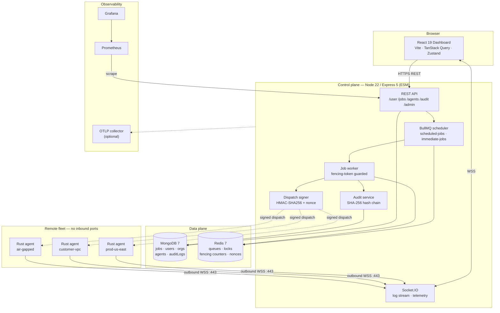
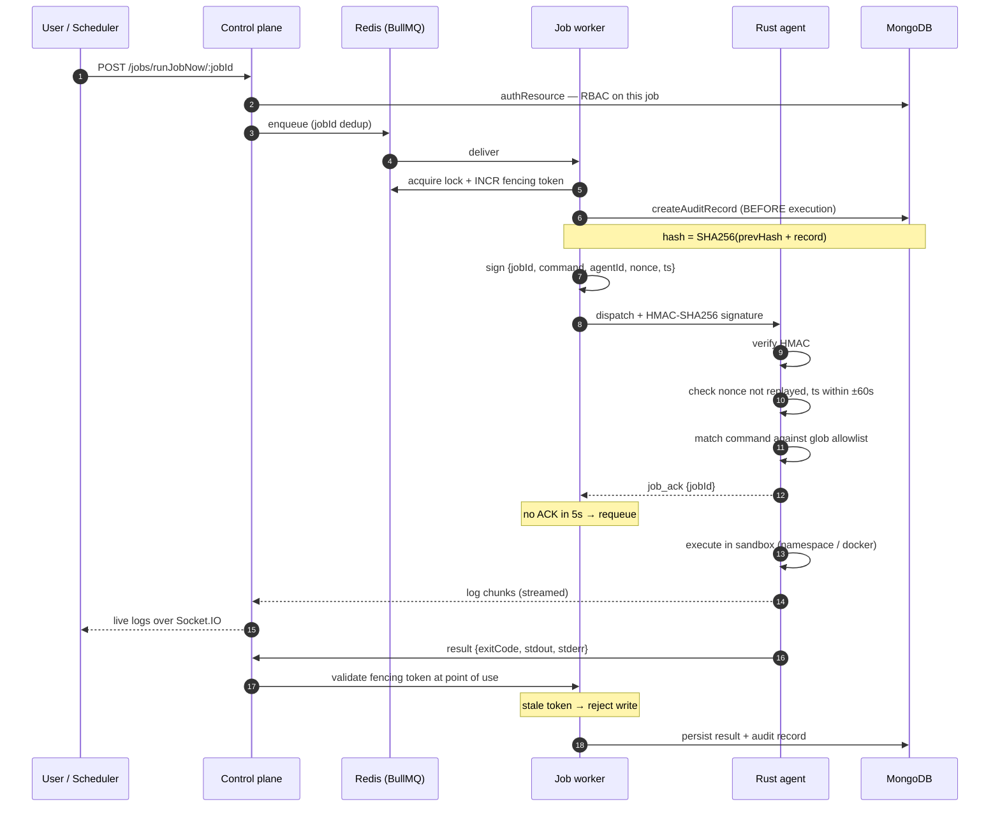
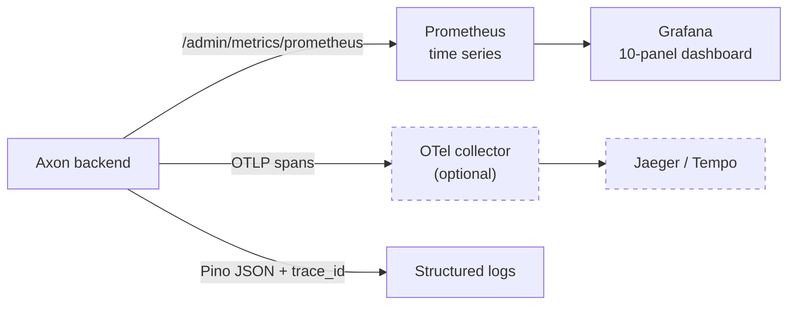
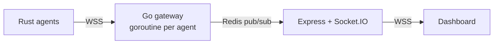

# Axon

**Distributed job orchestration for machines you can't SSH into.**

Axon schedules and runs jobs across remote infrastructure — on-prem servers, customer VPCs,
air-gapped networks — without inbound firewall rules, VPNs, or shared shell credentials.
Every execution is cryptographically signed on dispatch, verified at the agent, sandboxed at
runtime, and recorded in a hash-chained audit log that detects tampering after the fact.

```
Control plane (Node.js)  ──signed dispatch──▶  Rust agent  ──sandboxed exec──▶  your box
        ▲                                          │
        └──────── outbound WSS :443 only ──────────┘
```

---

## Table of Contents

- [The problem](#the-problem)
- [How it works](#how-it-works)
- [Job lifecycle](#job-lifecycle)
- [Security model](#security-model)
- [Features](#features)
- [Tech stack](#tech-stack)
- [Quick start](#quick-start)
- [Configuration](#configuration)
- [Observability](#observability)
- [API reference](#api-reference)
- [Testing](#testing)
- [Project layout](#project-layout)
- [Status and roadmap](#status-and-roadmap)
- [Documentation](#documentation)

---

## The problem

Axon exists to solve four specific production failures. Each one is a design constraint, not a
feature bullet.

### 1. Duplicate execution at scale

Run the same cron on 100 machines and you get 100 executions — or worse, you deduplicate with a
Redis lock, a worker GC-pauses past the lock TTL, and two workers execute concurrently while
each believes it holds the lock exclusively. This is
[Kleppmann's critique of Redlock](https://martin.kleppmann.com/2016/02/08/how-to-do-distributed-locking.html),
and it is not theoretical.

**Axon's answer:** at-least-once delivery with **fencing tokens**. Each lock acquisition carries
a monotonically incrementing counter, validated *at the point of use* rather than at acquisition.
A worker that stalled past its TTL fails the fencing check and its write is rejected.

> Axon does not claim exactly-once. Exactly-once delivery is unachievable over an asynchronous
> network. What Axon provides — at-least-once delivery plus idempotent execution — is the
> strongest correct guarantee available, and any system claiming otherwise is overselling.

### 2. SSH and firewalls block remote access

Getting inbound access to a customer's network means a VPN, a jump host, a firewall exception,
and a security review. It usually means never.

**Axon's answer:** agents dial **outbound over WSS on port 443**. Nothing listens. No inbound
port, no VPN, no firewall change. The same model used by GitHub Actions runners, Tailscale, and
Cloudflare Tunnel.

### 3. Audit trails that can't survive an auditor

A Mongoose `pre('save')` hook enforcing immutability protects against your application. It does
nothing against a rogue DBA with a `mongosh` session. When an auditor asks *"prove this record
wasn't modified after the fact,"* application-level immutability has no answer.

**Axon's answer:** a **SHA-256 hash chain**. Each audit record stores `prevHash` and
`recordHash`. Modifying any record invalidates every subsequent hash. `GET /audit/verify-chain`
replays the chain and reports the first break. Tampering becomes detectable rather than merely
discouraged.

### 4. Shell access is all-or-nothing

Giving a junior engineer the ability to restart a service means giving them a shell — and
therefore the ability to run anything.

**Axon's answer:** engineers get **jobs**, not shells. Named, pre-approved command payloads,
HMAC-signed by the control plane, checked against a per-agent glob allowlist, and executed
inside a namespace or Docker sandbox. Per-resource RBAC controls who can trigger which job on
which agent.

---

## How it works



**The direction of the arrows is the whole architecture.** The control plane never initiates a
connection to an agent. Agents connect out and hold the socket open; dispatch travels back down
a connection the agent itself established.

---

## Job lifecycle



Steps 9–11 are the security boundary. An agent rejects a dispatch that fails **any** of the
three checks — signature, freshness, allowlist — even if the WebSocket itself is authenticated.

---

## Security model

Defense in depth, boundary by boundary.

| Boundary | Control | Implementation |
|---|---|---|
| **User → API** | JWT auth, per-resource RBAC | `middlewares/jwt.js` — `authUser`, `authAdmin`, `authResource` |
| **User → Job** | Per-job/per-agent permission documents | `PATCH /jobs/:id/permissions`, `PATCH /agents/:agentId/permissions` |
| **API → Queue** | Zod validation at every route | `validateRequest(schema)` middleware |
| **Worker → Worker** | Fencing tokens, validated at point of use | `services/distributedLock.js` — Redis `INCR` + Lua ownership check on release |
| **Control plane → Agent** | HMAC-SHA256 signed dispatch | `utils/dispatchSigner.js` — `DISPATCH_SIGNING_KEY` |
| **Replay defense** | Nonce set + ±60s timestamp window | Signature covers `{jobId, command, agentId, nonce, timestamp}` |
| **Delivery** | Dispatch ACK with 5s timeout → requeue | `services/jobExecutionRouter.js` |
| **Agent identity** | 15-minute JWTs, refreshed every 12 min | `POST /agents/refresh-token` |
| **Agent → Command** | Per-agent glob allowlist | Rejected agent-side even with a valid signature |
| **Command → OS** | Namespace or Docker sandbox | `agent/src/sandbox.rs` |
| **Everything** | Immutable SHA-256 hash-chained audit log | `services/auditService.js` — `createAuditRecord()` |

### Sandbox modes

Set `AGENT_SANDBOX_MODE` on the agent:

| Mode | Isolation | Notes |
|---|---|---|
| `namespace` | `unshare --user --map-root-user --mount --pid --net --fork` + BPF seccomp filter | Linux only. Recommended default. |
| `docker` | `docker run --rm --network none --read-only <image>` | Requires a Docker daemon. Strongest isolation. |
| `none` | None — direct `sh -c` child process | **Current fallback when the variable is unset.** |

> ⚠️ **`AGENT_SANDBOX_MODE` defaults to `none`.** An agent started without it runs commands with
> the full privileges of the agent process. This is deliberate for backward compatibility with
> agents already in the field, but **set it explicitly in any environment you care about.**

### Audit chain verification

```bash
curl -H "Authorization: Bearer $TOKEN" https://your-host/audit/verify-chain
```

Returns the chain status and, on failure, the first record where the hash does not match. A
Prometheus counter (`axon_audit_chain_verification_failures_total`) increments on any break, so
tampering is alertable rather than merely discoverable.

---

## Features

<table>
<tr><td width="50%" valign="top">

### Scheduling
- Redis-backed durable scheduling (BullMQ)
- Immediate and recurring (cron) execution
- At-least-once delivery, idempotent execution
- Exponential backoff retries
- BullMQ `jobId` dedup on enqueue

### DAG workflows
- Dependency-aware execution via `dependsOn`
- Circular dependency prevention
- Directed execution pipelines
- State machine in `services/dagStateManager.js`

### Multi-tenancy
- Every query is organization-scoped
- Shared agent pools across teams
- Hard data isolation between orgs
- Admin / user roles plus per-resource grants

</td><td width="50%" valign="top">

### Remote execution
- Lightweight Rust agents (Tokio + tungstenite)
- Outbound-only WSS on :443
- Shell and HTTP job types
- Exponential reconnect backoff (1s → 30s)
- Offline job queuing across reconnects

### Real-time
- Live log streaming over Socket.IO
- CPU/RAM telemetry every 5s
- Online/offline tracking, 3-missed-heartbeat threshold
- Dashboard with execution history

### Data pipelines
- Per-job MongoDB sink for stdout/stderr
- CSV / JSON / Excel export
- AES-256-GCM encrypted sink URIs

</td></tr>
</table>

---

## Tech stack

| Layer | Stack |
|---|---|
| **Control plane** | Node.js 22 · Express 5 (ESM) · Mongoose/MongoDB 7 · BullMQ + ioredis · Socket.IO · Zod · Pino · JWT |
| **Agent** | Rust (stable) · Tokio · tokio-tungstenite · serde · sys-info |
| **Frontend** | React 19 · TypeScript · Vite (rolldown) · Tailwind CSS v4 · TanStack Query v5 · Zustand v5 · Recharts · Framer Motion |
| **Observability** | OpenTelemetry (OTLP) · prom-client · Prometheus · Grafana |
| **Testing** | Vitest · Supertest · mongodb-memory-server |
| **Deploy** | Docker Compose (local) · Azure Container Apps + Static Web Apps (production) |

---

## Quick start

### Docker Compose (recommended)

```bash
git clone https://github.com/YashManek1/Axon.git
cd Axon

# 1. Backend environment
cp backend/.env.example backend/.env
#    Generate real secrets:
#      openssl rand -hex 32   → JWT_SECRET
#      openssl rand -hex 32   → ENCRYPTION_KEY (must be exactly 64 hex chars)
#      openssl rand -hex 32   → DISPATCH_SIGNING_KEY

# 2. Compose environment — these two have NO defaults and compose will
#    refuse to start without them.
cat > .env <<'EOF'
PROMETHEUS_BEARER_TOKEN=dev-scrape-token
GRAFANA_ADMIN_PASSWORD=change-me-locally
EOF

# 3. Prometheus reads its scrape credential from a mounted file, not an env var.
mkdir -p observability/prometheus
printf '%s' 'dev-scrape-token' > observability/prometheus/token

# 4. Start
docker compose up -d
```

| Service | URL |
|---|---|
| Frontend | http://localhost |
| Backend API | http://localhost:3000 |
| Grafana | http://127.0.0.1:3001 — `admin` / `$GRAFANA_ADMIN_PASSWORD` |
| Prometheus | http://127.0.0.1:9090 |

Grafana and Prometheus are bound to loopback deliberately — they carry operational data and
Prometheus has no authentication of its own.

The Rust agent is behind a compose profile and does not start by default:

```bash
docker compose --profile agent up -d
```

### Manual setup

<details>
<summary><b>Prerequisites and per-service commands</b></summary>

Requires Node.js 22+, MongoDB 7, Redis 7, and a stable Rust toolchain.

```bash
# Backend
cd backend
cp .env.example .env        # fill in real secrets
npm install
npm run dev                 # nodemon on :3000

# Frontend
cd frontend
npm install
npm run dev                 # Vite on :5173
# Proxies /user /jobs /admin /agents /audit /socket.io → localhost:3000

# Rust agent
cd agent
cp .env.example .env.agent  # AGENT_ID, AGENT_API_KEY, CONTROL_PLANE_URL,
                            # DISPATCH_SIGNING_KEY, AGENT_SANDBOX_MODE
cargo run
```

</details>

See [RUNBOOK.md](RUNBOOK.md) for the full walkthrough: registering an org, provisioning an
agent, and running a first job.

---

## Configuration

### Backend

| Variable | Required | Description |
|---|---|---|
| `MONGO_URI` | ✅ | MongoDB connection string |
| `REDIS_URI` | ✅ | Redis connection string |
| `JWT_SECRET` | ✅ | Minimum 32 characters |
| `ENCRYPTION_KEY` | ✅ | Exactly 64 hex characters (AES-256-GCM) |
| `DISPATCH_SIGNING_KEY` | ✅ | Minimum 32 hex chars. **Must match the agent's value.** |
| `PORT` | | Default `3000` |
| `NODE_ENV` | | `development` / `production` |
| `LOG_LEVEL` | | `debug` / `info` / `warn` |
| `OTEL_EXPORTER_OTLP_ENDPOINT` | | Enables tracing. Unset ⇒ OTel is a no-op. |
| `OTEL_EXPORTER_OTLP_HEADERS` | | Comma-separated `key=value` exporter auth headers |
| `PROMETHEUS_BEARER_TOKEN` | | Guards `/admin/metrics/prometheus` |
| `EMAIL_SMTP_*`, `EMAIL_FROM` | | Optional notification transport |

All environment access goes through `config/environment.js`, which validates against a Zod
schema at startup. A missing or malformed variable fails the process immediately rather than at
first use. **Never read `process.env` at a call site.**

### Agent

| Variable | Required | Description |
|---|---|---|
| `AGENT_ID` | ✅ | Assigned at registration |
| `AGENT_API_KEY` | ✅ | Exchanged for short-lived JWTs |
| `CONTROL_PLANE_URL` | ✅ | e.g. `wss://api.yourdomain.com` |
| `DISPATCH_SIGNING_KEY` | ✅ | Must match the backend |
| `AGENT_SANDBOX_MODE` | | `namespace` \| `docker` \| `none` (default `none` — set it) |
| `AGENT_SANDBOX_DOCKER_IMAGE` | | Image for `docker` mode, e.g. `alpine:3.19` |

### Frontend

| Variable | Development | Production |
|---|---|---|
| `VITE_API_BASE_URL` | `http://localhost:3000` | `https://api.yourdomain.com` |
| `VITE_SOCKET_URL` | `http://localhost:3000` | `https://api.yourdomain.com` |

In development Vite proxies API paths automatically; these matter only for cross-origin
production builds.

---

## Observability

Three layers, each answering a different question.



- **Metrics — "is it healthy?"** Prometheus scrapes counters, gauges, and histograms every 10s.
- **Traces — "where did this request spend its time?"** OpenTelemetry propagates a trace context
  across the request, so a slow job dispatch can be attributed to a specific span.
- **Logs — "what exactly happened?"** Pino emits structured JSON carrying `requestId` and
  `trace_id`, so a log line joins directly to its trace.

### Exported metrics

| Metric | Type | Meaning |
|---|---|---|
| `axon_http_request_duration_seconds` | Histogram | Request latency by route, method, status |
| `axon_http_request_total` | Counter | Request volume |
| `axon_job_execution_duration_seconds` | Histogram | End-to-end job execution time |
| `axon_agent_dispatch_ack_latency_seconds` | Histogram | Dispatch → ACK round trip |
| `axon_queue_depth` | Gauge | Pending work by `queue` and `state` |
| `axon_audit_chain_verification_failures_total` | Counter | Audit tamper signal — **alert on any increase** |

Every label set is bounded. Unbounded label cardinality is the standard way to destroy a
Prometheus instance, so route labels use the Express route pattern, never the raw URL.

Grafana is provisioned automatically from
[`observability/grafana/provisioning/`](observability/grafana/provisioning/) — the datasource
and the dashboard both exist on first boot with no manual clicking.

> **Tracing is instrumented but has no destination by default.** Set
> `OTEL_EXPORTER_OTLP_ENDPOINT` and run a collector (Jaeger, Tempo, or the OTel Collector) to
> capture spans. Metrics work with no additional setup.

---

## API reference

All routes require `Authorization: Bearer <jwt>` except registration, login, and health.

<details>
<summary><b>Full endpoint table</b></summary>

### `/user`
| Method | Path | Auth | Purpose |
|---|---|---|---|
| POST | `/user/register` | — | Create user + organization |
| POST | `/user/login` | — | Issue JWT |
| POST | `/user/logout` | — | Invalidate session |
| POST | `/user/refresh` | — | Refresh session token |

### `/jobs`
| Method | Path | Auth | Purpose |
|---|---|---|---|
| POST | `/jobs/createJob` | user | Create a job definition |
| GET | `/jobs/getJobs` | user | List org jobs |
| GET | `/jobs/getJobById/:jobId` | user | Fetch one job |
| PUT | `/jobs/updateJob/:id` | user | Update definition |
| DELETE | `/jobs/deleteJob/:jobId` | user | Delete |
| PATCH | `/jobs/toggleJobStatus/:jobId` | user | Enable / disable |
| POST | `/jobs/runJobNow/:jobId` | user + resource | Trigger immediately |
| PATCH | `/jobs/:id/permissions` | admin | Set per-job grants |

### `/agents`
| Method | Path | Auth | Purpose |
|---|---|---|---|
| GET | `/agents/getAgents` | user | List org agents |
| GET | `/agents/getAgent/:agentId` | user | Agent detail + telemetry |
| POST | `/agents/register` | — | Provision a new agent |
| POST | `/agents/refresh-token` | agent token | Rotate the 15-min JWT |
| POST | `/agents/:agentId/rotate-key` | admin | Rotate the API key |
| PATCH | `/agents/:agentId/permissions` | admin | Set allowlist / grants |
| DELETE | `/agents/:agentId` | admin | Decommission |

### `/audit`
| Method | Path | Auth | Purpose |
|---|---|---|---|
| GET | `/audit/job/:jobId` | user | Audit history for a job |
| GET | `/audit/recent` | user | Recent org activity |
| GET | `/audit/logs` | user | Raw audit log lines |
| GET | `/audit/export` | user | Export (CSV / JSON / Excel) |
| GET | `/audit/run/:auditId` | user | One execution record |
| GET | `/audit/run/:auditId/logs` | user | Logs for one execution |
| GET | `/audit/verify-chain` | user | **Verify the hash chain** |

### `/admin`
| Method | Path | Auth | Purpose |
|---|---|---|---|
| GET | `/admin/health` | — | Liveness + dependency check |
| GET | `/admin/job-stats` | admin | Job aggregates |
| GET | `/admin/user-stats` | admin | User aggregates |
| GET | `/admin/all-jobs` | admin | Cross-org job list |
| GET | `/admin/all-users` | admin | Cross-org user list |
| GET | `/admin/org-analytics` | admin | Org-level analytics |
| GET | `/admin/metrics` | admin | Prometheus text format, session-gated |
| GET | `/admin/metrics/prometheus` | bearer token | Prometheus text format, for the scraper |

</details>

[`backend/swagger.yaml`](backend/swagger.yaml) holds the OpenAPI spec. It documents all 34 live
routes and is verified in sync with `backend/routes/*.js` as of 2026-08-12.

---

## Testing

```bash
cd backend
npm test              # vitest run
npm run test:watch
npm run test:coverage
```

**Current: 190 tests across 25 files, all passing.** Tests use `mongodb-memory-server` locally;
CI runs against real `mongo:7` and `redis:7-alpine` service containers
([`.github/workflows/ci.yml`](.github/workflows/ci.yml)).

```bash
cd agent && cargo test && cargo clippy -- -D warnings
```

> **Known issue:** `npx vitest` currently fails with `ERR_PNPM_IGNORED_BUILDS: protobufjs` — a
> transitive dependency of the OTLP exporter whose build script pnpm blocks. Use `npm test`, or
> add `protobufjs` to `onlyBuiltDependencies` in `pnpm-workspace.yaml`.

---

## Project layout

```
Axon/
├── backend/                     Node 22 · Express 5 · ESM control plane
│   ├── config/                  environment.js (Zod), logger.js, queue.js
│   ├── controllers/             route handlers
│   ├── middleware(s)/           requestId, jwt, RBAC, validation
│   ├── models/                  Mongoose schemas — job, agent, user, auditLog
│   ├── routes/                  /user /jobs /agents /audit /admin
│   ├── services/                auditService, distributedLock, dagStateManager,
│   │                            jobExecutionRouter
│   ├── utils/dispatchSigner.js  HMAC-SHA256 dispatch signing
│   ├── workers/                 BullMQ job + telemetry workers
│   ├── instrumentation.js       OpenTelemetry bootstrap
│   ├── metrics.js               Prometheus registry
│   └── tests/                   Vitest — unit, integration, e2e
├── agent/                       Rust · Tokio · tungstenite
│   └── src/                     connection.rs, execution.rs, sandbox.rs, main.rs
├── frontend/                    React 19 · Vite · Tailwind v4
├── observability/
│   ├── prometheus/              scrape config (credential mounted, never committed)
│   └── grafana/provisioning/    datasource + 10-panel dashboard
├── docs/                        audits, roadmap, deployment
└── docker-compose.yml           full local stack
```

---

## Status and roadmap

**Working today:** everything in [Features](#features) and [Security model](#security-model).

| Tier | Item | Status |
|---|---|---|
| 1 | Hash-chained immutable audit log | ✅ |
| 1 | Fencing tokens for distributed locks | ✅ |
| 1 | HMAC-signed dispatch + replay defense | ✅ |
| 1 | Dispatch ACK with requeue on timeout | ✅ |
| 2 | CI registry push + Azure deploy workflow | ✅ |
| 2 | Dev Mongo auth + Key Vault secrets | ✅ |
| 2 | Mongo service container in CI | ✅ |
| 2 | OpenTelemetry + Prometheus + Grafana | ✅ |
| 3 | Short-lived agent JWTs | ✅ |
| 3 | Per-resource RBAC | ✅ |
| 3 | Sandboxed agent execution | ✅ |
| 3 | WORM export / external chain anchoring | ⬜ Not started |
| 3 | Go log-stream gateway | ⬜ Not started |

**Known gaps:**
- `AGENT_SANDBOX_MODE` defaults to `none` — no startup warning is emitted.
- HTTP job type is supported by the backend but has no UI form fields.
- `swagger.yaml` lags the implemented routes.
- Tracing has no default collector in `docker-compose.yml`.

### Planned: Go log-stream gateway

The scale ceiling is agent WebSocket fan-out. Node serializes on a single event loop; a
goroutine-per-connection model handles the same load at ~2KB of stack per connection.



Only the agent-facing connection layer moves. All CRUD, auth, scheduling, and BullMQ workers
stay in Node. Migration is feature-flagged and dual-run — see
[docs/tech-audit.md](docs/tech-audit.md).

---

## Documentation

| Document | Contents |
|---|---|
| [RUNBOOK.md](RUNBOOK.md) | Operational walkthrough: setup, registration, running jobs |
| [docs/tech-roadmap.md](docs/tech-roadmap.md) | Security and platform roadmap with implementation status |
| [docs/tech-audit.md](docs/tech-audit.md) | The four pain points, what each optimally requires, where Axon sits |
| [docs/api-audit.md](docs/api-audit.md) | Backend surface vs. frontend consumption |
| [docs/deploy-azure.md](docs/deploy-azure.md) | Azure deployment with cost breakdown |
| [backend/swagger.yaml](backend/swagger.yaml) | OpenAPI spec (partial) |

---

## Author

**Yash Manek** — Backend & Distributed Systems Engineer

Distributed systems · autonomous workflows · AI infrastructure · developer tooling
