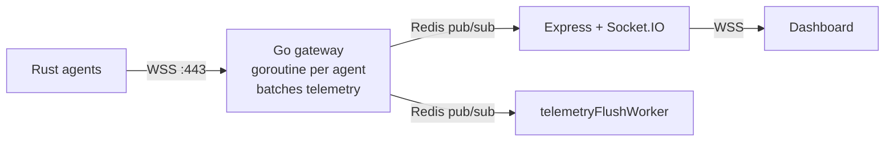

# Axon — Tech-Level Audit

> **Last verified against source: 2026-08-12.** Original audit: 2026-06-03.
>
> **Framing:** Axon's positioning makes four concrete production-grade correctness claims. This
> document evaluates each against what the claim *optimally* requires, and states where the
> implementation actually sits — with file references, so the claim can be checked rather than
> trusted.

> ⚠️ **If you are reading a cached or forked copy:** the 2026-06-03 revision of this file
> described nine items as "gap" that have since shipped. Anything asserting that Axon lacks
> dispatch ACK, allowlist enforcement, RBAC, hash-chain verification, sandboxing, or
> observability is out of date. Verify against source before quoting.

---

## Summary

| Pain point | Claim status | Remaining gap |
|---|---|---|
| 1 — Duplicate execution | ✅ Closed correctly | Honest framing required (at-least-once, not exactly-once) |
| 2 — SSH/firewall bypass | ✅ Closed | Scale ceiling beyond ~500 concurrent agents |
| 3 — Immutable audit trail | ✅ Closed at the application layer | WORM export + external anchoring not started |
| 4 — Jobs replace shell | ✅ Closed | Sandbox defaults to `none` when unset |

---

## Pain Point 1 — Duplicate Cron Execution at Scale

### The claim

> "Even if 100 servers enqueue the same job simultaneously, only one executes."

### What optimal actually requires

True exactly-once is unattainable over an asynchronous network. The provably correct model is
**at-least-once delivery plus idempotent execution guarded by fencing tokens**.

The failure modes a plain SETNX lock does not survive:

- **Lock expiry race** ([Kleppmann's critique of Redlock](https://martin.kleppmann.com/2016/02/08/how-to-do-distributed-locking.html)):
  a worker holds a lock, GC- or IO-pauses for longer than the TTL, the lock expires, a second
  worker acquires it. Both now execute concurrently and neither is aware of the other.
- **BullMQ stalled-job redelivery:** BullMQ marks a job stalled when a worker dies mid-execution
  and redelivers it. A correctly-behaved execution can be re-run after a transient crash.

The defense is a **fencing token** — a monotonically incrementing counter attached to each lock
acquisition and passed through to the execution sink. The sink rejects any write carrying a
token ≤ the last-seen token for that job. Re-execution becomes a cheap no-op rather than a
double-write.

### Current implementation — ✅ closed

`backend/services/distributedLock.js` implements Redis `SETNX` + TTL **plus** a per-job `INCR`
fencing counter returned with the lock. Release is guarded by a Lua script that verifies
ownership atomically, so a worker cannot release a lock it no longer holds.

**Critically, the token is validated at the point of use, not at acquisition.** A worker that
acquired a lock, stalled past the TTL, and resumed finds its write rejected. Regression coverage
lives in `backend/tests/fencingToken.test.js` and `backend/tests/distributedLock.test.js`.

BullMQ `jobId` deduplication additionally drops duplicate enqueues while a job exists in the
queue, covering the enqueue race separately from the execution race.

### Remaining

Documentation honesty, which the README now carries explicitly: Axon provides **at-least-once
delivery with idempotent execution**, not exactly-once. Any distributed system claiming
exactly-once as a hard guarantee is overselling.

---

## Pain Point 2 — SSH/Firewall Blocked

### The claim

> "The agent dials out on port 443. IT cannot object to HTTPS."

### What optimal actually requires

The outbound-only model is architecturally correct and matches production-grade systems (GitHub
Actions runners, Tailscale, Cloudflare Tunnel). It is best-in-class at the architecture level.
The gaps are at hardening and scale:

- **Auth model:** a static long-lived `apiKey` means a leak persists until noticed. Optimal is
  short-lived signed tokens that auto-expire.
- **Dispatch reliability:** without acknowledgement, a job whose WebSocket frame was delivered to
  an agent that then crashed is marked dispatched but never executed — silently lost.
- **Scale ceiling:** Node runs a single event loop. Each agent holds an open WebSocket. Telemetry
  fan-out across many simultaneous agents serializes on that loop.

### Current implementation — ✅ closed (auth + reliability); scale ceiling remains

`agent/src/connection.rs` — Tokio + tungstenite client, exponential reconnect backoff 1s→30s,
offline job queuing across reconnects.

**Short-lived agent JWTs are implemented.** Agents exchange the API key for a 15-minute JWT and
refresh it every 12 minutes via `POST /agents/refresh-token`
(`backend/routes/agentProvisioningR.js:15`). `POST /agents/:agentId/rotate-key` allows an admin
to invalidate a compromised key. Coverage: `backend/tests/agentShortToken.test.js`.

**Dispatch ACK is implemented.** The agent emits `job_ack {jobId}` on receipt; the control plane
requeues after a 5-second timeout (`backend/services/jobExecutionRouter.js`). Coverage:
`backend/tests/dispatchAck.test.js`.

### Remaining — the scale ceiling

Not a problem at current agent counts; becomes one beyond roughly 500 concurrent agents. The
planned fix is the Go gateway extraction described at the end of this document.

---

## Pain Point 3 — Immutable Audit Trail

### The claim

> "Before every execution, Axon writes an AuditLog. Immutable fields cannot be modified after
> the fact."

### What optimal actually requires

A Mongoose `pre('save')` hook is **application-level immutability only**. Anyone with direct
MongoDB write access — a rogue DBA, a compromised service account, a `mongosh` session — can
`db.auditlogs.updateOne(...)` leaving no trace. That does not satisfy a SOC 2 or HIPAA
tamper-evidence requirement where the auditor asks *"prove this record was not modified."*

Three layers are required, in increasing strength:

1. **Cryptographic hash-chaining** — each record stores `sha256(prevHash + serialized_record)`.
   A verifier replays the chain and detects any gap or modification.
2. **WORM storage** — export to a write-once medium (S3 Object Lock, Azure Blob immutability, or
   a ledger DB such as QLDB or immudb).
3. **External anchoring** — periodically publish the chain head somewhere externally observable,
   so the anchor itself cannot be retroactively rewritten.

### Current implementation — ✅ layer 1 closed

`backend/services/auditService.js` implements SHA-256 hash chaining. Every record carries
`prevHash` and `recordHash`; modifying any record invalidates every hash after it.

- **All writes go through `createAuditRecord()`.** Calling `AuditLog.create()` directly bypasses
  required fields and breaks the chain silently — this is a hard project invariant, not a style
  preference.
- **`GET /audit/verify-chain`** (`backend/routes/auditR.js:21`) replays and validates the chain,
  reporting the first record where the hash does not match.
- **Verification failures are alertable.** `axon_audit_chain_verification_failures_total`
  increments on any break, so tampering surfaces as a Prometheus alert rather than waiting for
  someone to run the endpoint manually.
- Coverage: `backend/tests/auditChain.test.js`, `backend/tests/auditService.test.js`,
  `backend/tests/e2e/auditCompliance.test.js`.

The chain is append-only. There is no legitimate update or delete path.

### Remaining — layers 2 and 3

WORM export and external anchoring are **not started**. This is the last item standing between
the current implementation and a defensible answer to a strict external auditor. Concretely:

1. A scheduled job archiving records older than 24h to Azure Blob Storage with an immutability
   policy applied.
2. Periodic publication of the chain head to an externally-observable location.

---

## Pain Point 4 — Jobs Replace Shell Access

### The claim

> "Engineers don't get a shell — they get Jobs: named, pre-approved command payloads. A junior
> engineer can trigger 'Restart API Service.' They cannot run anything else."

### What optimal actually requires

The control plane defining a payload is not sufficient if the agent executes whatever string
arrives over an authenticated socket. A compromised control plane, or anyone who can reach the
socket, dispatches arbitrary commands. Four layers are needed:

1. **Signed job definitions** — the agent verifies a signature before execution, so a tampered
   payload is rejected at the execution boundary rather than the transport boundary.
2. **Agent-side allowlist** — an out-of-policy command is rejected even when the signature is
   valid. This bounds the blast radius of a compromised signing key.
3. **Sandboxed execution** — commands run under restricted filesystem, network, and process
   namespaces rather than as a bare child of the agent.
4. **Fine-grained RBAC** — beyond binary admin/user: user A may trigger Job X on Agent Y but not
   Job Z.

### Current implementation — ✅ all four closed

**1. HMAC-signed dispatch.** `backend/utils/dispatchSigner.js` signs
`{jobId, command, agentId, nonce, timestamp}` with HMAC-SHA256 under `DISPATCH_SIGNING_KEY`
(≥32 hex chars). The agent verifies before execution. Replay is defended by a nonce set plus a
±60-second timestamp window — a captured dispatch cannot be replayed later. Coverage:
`backend/tests/dispatchSigning.test.js`.

> The dispatch payload shape is a **wire protocol**. Changing it means shipping backend and agent
> together, or versioning the change. Agents in the field do not upgrade in lockstep.

**2. Per-agent glob allowlist.** Configured via `PATCH /agents/:agentId/permissions` and enforced
agent-side. A command outside the allowlist is rejected even with a valid signature.

**3. Sandboxed execution.** `agent/src/sandbox.rs` — three modes:

| Mode | Mechanism |
|---|---|
| `namespace` | `unshare --user --map-root-user --mount --pid --net --fork` + BPF seccomp filter via `pre_exec`. Linux only. |
| `docker` | `docker run --rm --network none --read-only <image>` |
| `none` | Direct `sh -c` (or `cmd /C` on Windows) |

Coverage: `backend/tests/sandboxMode.test.js` plus unit tests in `sandbox.rs`.

**4. Per-resource RBAC.** `authResource` in `backend/middlewares/jwt.js` enforces per-job and
per-agent grants, applied at `POST /jobs/runJobNow/:jobId`. Permission documents are managed via
`PATCH /jobs/:id/permissions` and `PATCH /agents/:agentId/permissions`. Coverage:
`backend/tests/resourceAuth.test.js`.

`backend/services/dagStateManager.js` enforces DAG dependency ordering correctly.

### Remaining — the sandbox default

`SandboxMode::from_vars` falls through to `Self::None` when `AGENT_SANDBOX_MODE` is unset
(`agent/src/sandbox.rs:42-56`). An operator who deploys an agent without setting it gets **no
isolation**, with no startup warning.

This is deliberate — changing the default would break agents already deployed in the field —
but it is the highest-value remaining hardening item. Two options, neither yet implemented:

1. Emit a loud startup warning when the mode resolves to `None`.
2. Make the mode a required variable in a future agent major version, so the failure is a
   startup error rather than a silent downgrade.

---

## Cross-Cutting Platform Gaps

| Gap | Severity | Status |
|---|---|---|
| Stale `swagger.yaml` — missing endpoints | Medium | ✅ Closed 2026-08-12 — all 34 live routes documented |
| No registry push in CI | High | ✅ Closed — `.github/workflows/deploy.yml` |
| Dev Mongo has no auth | Medium | ✅ Closed — `MONGO_INITDB_ROOT_*` in `docker-compose.yml` |
| No observability | Medium | ✅ Closed — OTel + Prometheus + provisioned Grafana |
| Secrets only in `.env`, no Key Vault | Medium-High | ✅ Closed — Key Vault `secretRef`, see `docs/deploy-azure.md` |
| CI flakiness from `mongodb-memory-server` binary download | Low-Medium | ✅ Closed — `mongo:7` service container in CI |
| Node 20 → 22 upgrade | Low | ✅ Closed |
| Tracing instrumented but no collector in compose | Low | ⬜ Open — set `OTEL_EXPORTER_OTLP_ENDPOINT` and run Jaeger/Tempo |
| HTTP job type has no UI form fields | Low | ⬜ Open — backend supports it, frontend does not expose it |
| `ERR_PNPM_IGNORED_BUILDS: protobufjs` breaks `npx vitest` | Low | ⬜ Open — needs `onlyBuiltDependencies` in `pnpm-workspace.yaml` |

---

## Planned Architecture — Partial Go Extraction

The remaining high-impact upgrade targets **Pain Point 2's scale ceiling**: extract the agent
connection and telemetry/log-stream gateway to a Go microservice.



**Why Go for this path:**

- Goroutines cost ~2KB of stack versus roughly 1MB of per-connection overhead in Node. At 10,000
  concurrent agents that is ~20MB versus ~10GB for connection state alone.
- A read/write pump per connection avoids event-loop serialization on the fan-out path.
- Channels and `sync/atomic` replace the Node-level `agentTelemetryBuffer` and
  `logStreamBroker`, removing shared-mutable-state hazards.
- Compiles to a static binary — easy to containerize and ship alongside the Rust agent.

**Migration path (zero-downtime, feature-flagged):**

1. Define the Redis pub/sub message contract: `{ agentId, jobId, stream, line, timestampMs }`.
2. Build the gateway as an independent binary in `gateway/`. It terminates agent WebSockets,
   validates agent JWTs, and publishes events to Redis.
3. Feature-flag the handshake route via `AGENT_GATEWAY_URL`.
4. Dual-run for one sprint; compare telemetry parity across both paths.
5. Retire the Node path — remove `services/logStreamBroker.js`,
   `services/agentTelemetryBuffer.js`, `workers/telemetryFlushWorker.js`.

**What stays in Node:** all CRUD (jobs, agents, audit, users, orgs), auth, job scheduling, BullMQ
workers, and Socket.IO fan-out to UI clients. Go handles only the agent-facing connection layer.

---

## How to re-verify this document

Do not trust it. Each claim above cites a file. To confirm the status of any item:

```bash
# Structure of a subsystem
code-review-graph query file_summary <path> --repo "c:/My Project/Axon"

# Test coverage for a specific claim
cd backend && npm test -- <testfile>
```

The authoritative roadmap with per-item implementation status is
[docs/tech-roadmap.md](tech-roadmap.md). When the two disagree, the roadmap and the source win.
